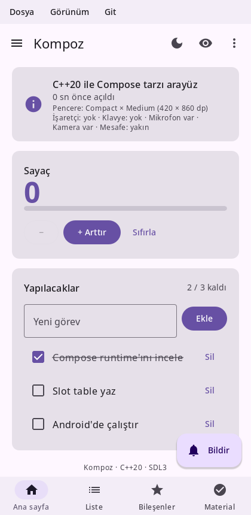
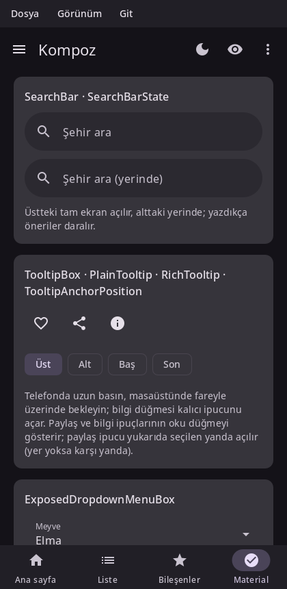
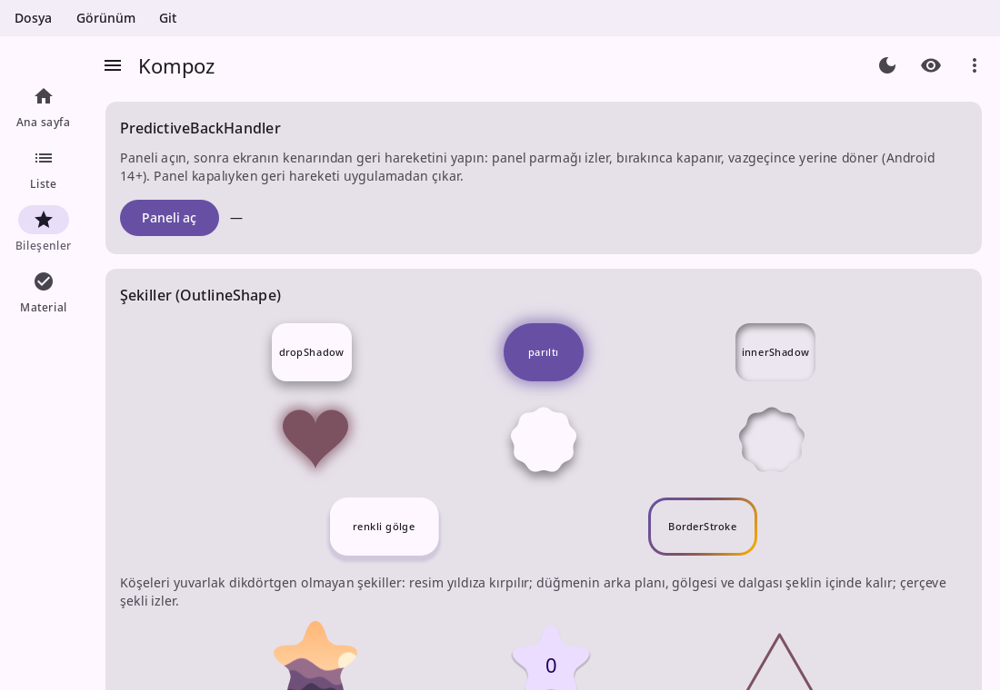
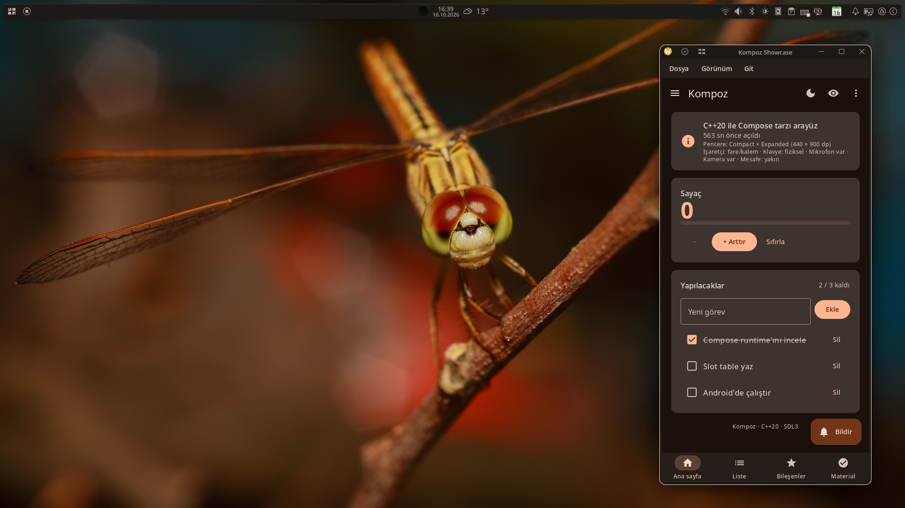
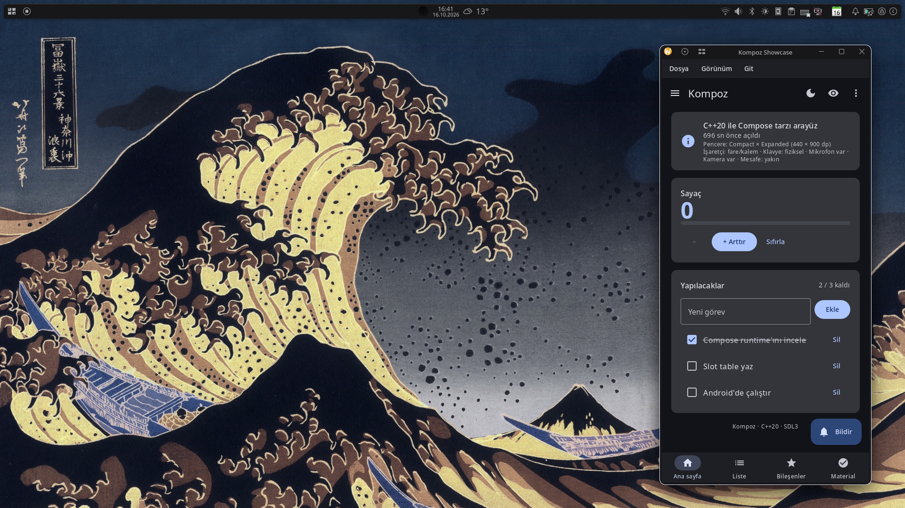
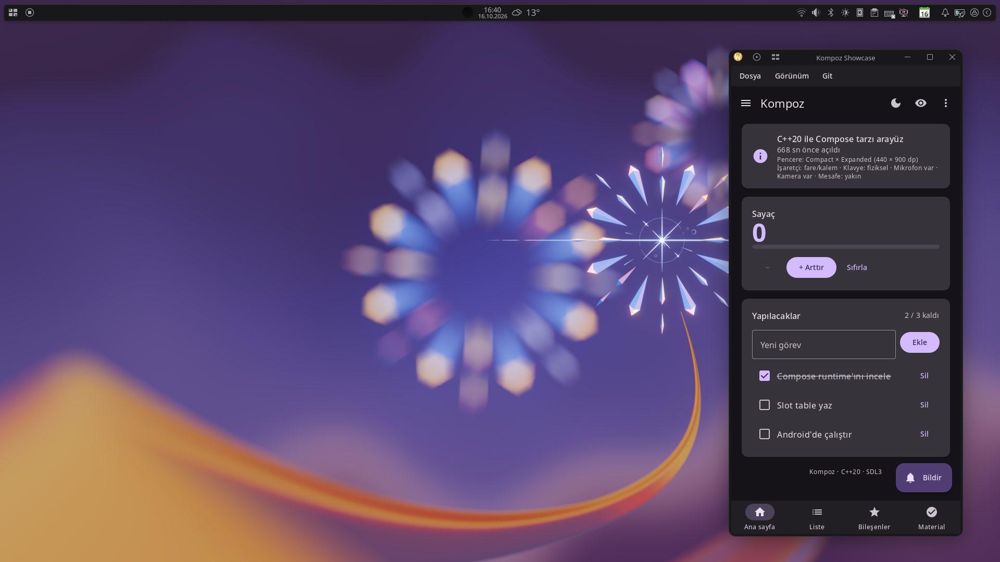

# Kompoz

[English](README.md) · **Türkçe**

C++20 için Jetpack Compose tarzı, deklaratif ve çok platformlu bir arayüz kütüphanesi: aynı düşünme biçimi
(composable fonksiyonlar, durum, recomposition, modifier'lar), C++'ın izin verdiği yerde aynı isimler ve Compose'unkiler
gibi görünen ve davranan Material 3 bileşenleri. Tek kod tabanından Linux, Windows, Android ve web'de çalışır.

Sürüm 0.1.1. API Compose'u yakından izliyor ama henüz değişebilir.
[Apache Lisansı 2.0](LICENSE) ile lisanslıdır.

<p>


</p>





```cpp
#include <kompoz/kompoz.hpp>
using namespace kompoz;

void Counter() {
    auto count = remember([] { return mutableStateOf(0); });

    Column(Modifier().padding(16), {.verticalArrangement = Arrangement::spacedBy(8)}, [&] {
        Text("Sayaç: " + std::to_string(count.get()), {.font = typography().titleLarge});
        Button([count] { count.set(count.get() + 1); }, [] { Text("Arttır"); });
    });
}

kompoz::Application kompoz::createApplication(int, char**) {
    return {.title = "Demo", .content = [] { MaterialTheme(lightColorScheme(), Counter); }};
}
```

## İçinde neler var

- **Runtime**: akıllı recomposition'lı composable fonksiyonlar (yalnız değişen durumu okuyan yeniden çalışır,
  değişmeyen çocuklar atlanır), `remember`/`rememberSaveable`, efektler, `CompositionLocal`, C++20 coroutine'leri
  (`LaunchedEffect`, `delay`, `Flow`/`StateFlow`), `ViewModel`, tür güvenli rotalar ve derin bağlantılarla gezinme,
  yaşam döngüsü.
- **Yerleşim**: artımlı (bir düğüm ancak içinde bir şey değişince yeniden ölçülür), `Box`/`Row`/`Column`, `FlowRow`,
  `FlexBox`, `Grid`, özel `Layout` ve `SubcomposeLayout`, intrinsic'ler, pencere kenar boşlukları, sağdan sola.
- **Listeler ve kaydırma**: `LazyColumn`/`LazyRow`/tembel ızgaralar/kademeli ızgaralar, pager'lar, carousel'ler, iç içe
  kaydırma, Android'in fling eğrisi ve kenar esnemesi, yakalama (snap), fare tekerleği ve dokunmatik yüzey.
- **Material 3** (Compose Material 3 1.4, Expressive bileşenler dahil): Scaffold ve uygulama çubukları, gezinme
  çubukları, raylar ve çekmeceler, `NavigationSuiteScaffold`, butonlar ve buton grupları, kartlar, chip'ler, listeler,
  slider'lar, anahtarlar, sekmeler, metin alanları, tarih ve saat seçiciler, diyaloglar, menüler, alt sayfalar,
  snackbar'lar, ipuçları, arama çubukları, ilerleme ve yükleme göstergeleri, carousel'ler, dinamik renkli `MaterialTheme`.
- **Çizim ve metin**: `Canvas`/`DrawScope`, fırçalar, path'ler, her şekille kırpma ve çerçeve, bulanık gölgeler,
  `graphicsLayer`, vektör resimler, `AsyncImage` (JPEG, PNG, WebP, HTTP üzerinden), HarfBuzz ile metin şekillendirme,
  iki yönlü metin, `AnnotatedString`, seçim, emoji ve sistem yedek fontları.
- **Girdi**: dokunma, çoklu dokunma hareketleri, fare (üzerine gelme, sağ tık, fareyle metin seçimi), klavye odağı ve
  kısayollar, önerili yazılım klavyesi, sürükle-bırak, tahmine dayalı geri hareketi.
- **Erişilebilirlik**: Android'de TalkBack'in, Linux'ta AT-SPI (Orca) ve Windows'ta UI Automation (Ekran Okuyucusu,
  NVDA) üzerinden ekran okuyucuların okuduğu semantik ağaç: etiketler, roller, durumlar, eylemler, özel eylemler,
  canlı bölgeler.
- **Platformla bütünleşme**: sistemin koyu modu; kaynağını uygulamanın (ya da kullanıcısının) seçtiği dinamik renk:
  sistemin paleti (Android 12+'da duvar kağıdınınki, Linux ve Windows'ta masaüstünün vurgu rengi) ya da duvar kağıdının kendisi
  (Linux masaüstleri, Windows, Android 8.1+); sistem yazı ölçeği; sistemin dili (kütüphanenin kendi metinleri İngilizce ya da Türkçe, `LocalStrings`,
  ve sağdan sola yerleşim); pano, titreşim, URI'ler, IME.
- **Araçlar**: pencere açmadan UI testleri (`ComposeTestRule`), önizlemeler (`KOMPOZ_PREVIEW`), kaydedince uygulamanın
  durumunu koruyarak yeniden derleyip başlatma (`scripts/dev.sh`), betikle ekran görüntüsü, kare profili, her platform
  için paketleme (`scripts/package.sh`).

Her Compose API'sinin durumuyla tam liste [docs/components.tr.md](docs/components.tr.md)'de.

## Compose → Kompoz

| Compose | Kompoz |
|---|---|
| `@Composable` + compiler plugin | Her composable'da `CallSite site = CallSite::current()` (`std::source_location`) varsayılan parametresi. Çağrı noktası + ebeveyn içindeki sıra = kimlik |
| Restartable / skippable composable | `composable(site, args..., [=]{ ... })`: okuduğu state değişince tek başına yeniden çalışır, argümanları aynıysa atlanır |
| Inline composable (`Column`, `Row`) | `ComposableScope scope(site);`: kimlik verir ama ayrı scope değildir (içerik lambdası alan composable'lar için) |
| `remember { }`, `remember(key) { }` | `remember([]{...})`, `remember(key, []{...})` |
| `mutableStateOf` | `mutableStateOf(x)` → `MutableState<T>` (kopyalanabilir handle; callback'lerde değerle yakala) |
| `key(id) { }` | `key(id, [&]{...})` |
| `DisposableEffect`, `SideEffect` | Aynı isimler |
| `CompositionLocal` | `CompositionLocal<T>`, `CompositionLocalProvider({Local.provides(v)}, ...)` |
| `animate*AsState` | `animateFloatAsState`, `animateColorAsState` (sadece kendi scope'unu her frame yeniden çalıştırır) |
| `LaunchedEffect`, `rememberCoroutineScope`, `delay` | C++20 coroutine'leri: `LaunchedEffect(key, [=]() -> Task { co_await delay(1s); ... })` |
| `Animatable`, `tween`, `spring`, `infiniteRepeatable` | `co_await anim.animateTo(1.f, tween(300))`, aynı spec isimleri |
| `AnimatedVisibility`, `AnimatedContent`, `Crossfade` | Aynı isimler; `fadeIn() + expandVertically()`, `scaleIn()`, `togetherWith` |
| `NavHost(nav, "home") { composable("detail/{id}") { e -> } }`, `nav.navigate("detail/3")` | `NavHost(nav, "home", m, [&](NavGraphBuilder& g) { g.composable("detail/{id}", [&](const NavBackStackEntry& e) { e.arguments().getInt("id"); }); })`, `nav.navigate("detail/3", {.popUpTo = "home", .saveState = true, .restoreState = true})` |
| `@Serializable data class Profile(val id: String, val tab: Int? = null)`, `composable<Profile> { e -> e.toRoute<Profile>() }`, `nav.navigate(Profile("42"))` | `struct Profile { std::string id; std::optional<int> tab; KOMPOZ_ROUTE(Profile, id, tab) };` (zorunlu alanlar yol, `std::optional`'lar sorgu parametresi), `g.composable<Profile>([&](const NavBackStackEntry& e) { e.toRoute<Profile>(); })`, `nav.navigate(Profile{.id = "42"})`, `navigation<Login>(Username{}, …)`, `hasRoute<T>()`, `getBackStackEntry<T>()`, `navDeepLink<T>("kompoz://profile")` |
| `composable("item/{n}", deepLinks = listOf(navDeepLink { uriPattern = "kompoz://item/{n}" })) { … }` | `g.composable("item/{n}", {navDeepLink("kompoz://item/{n}")}, [&](const NavBackStackEntry& e) { … })`; `nav.navigate("kompoz://item/3")`, `nav.handleDeepLink(...)` |
| `navigation(startDestination = "username", route = "login") { composable("username") { … } }` | `g.navigation("username", "login", [&](NavGraphBuilder& login) { login.composable("username", [&](const NavBackStackEntry& e) { auto vm = viewModel<LoginViewModel>(*e.parent()); }); })` |
| `class SearchViewModel(private val state: SavedStateHandle) : ViewModel()`, `state.getStateFlow("q", "")`, `state["q"] = q` | `explicit SearchViewModel(SavedStateHandle s) : state(s), query(s.getStateFlow<std::string>("q", "")) {}`, `state.set("q", q)` (`viewModel<SearchViewModel>()` handle'ı kendisi verir; süreç ölümünden sonra da kalır) |
| `rememberSaveable { mutableStateOf(0) }` | `rememberSaveable([] { return mutableStateOf(0); })` (Android süreci bitirip geri getirince de) |
| `Saver(save = { … }, restore = { … })` | `template <> struct kompoz::Saver<Point> { static SavedValue save(const Point&); static std::optional<Point> restore(const SavedValue&); };` |
| `AsyncImage(model = url, contentDescription = "…", placeholder = …, contentScale = ContentScale.Crop)` (Coil) | `AsyncImage(url, "…", Modifier().size(120), {.placeholder = [] { … }, .error = [] { … }, .contentScale = ContentScale::Crop, .crossfadeMillis = 200});` (varlık yolu ya da http(s); JPEG, PNG, WebP; kutunun boyutunda çözülür, indirilenler diskte kalır) |
| `val vm: MyViewModel = viewModel()` | `auto vm = viewModel<MyViewModel>();` (`class MyViewModel : public ViewModel`, `viewModelScope()`, `onCleared()`) |
| `SharedTransitionLayout { AnimatedContent(x) { Modifier.sharedElement(rememberSharedContentState(key), this@AnimatedContent) } }` | `SharedTransitionLayout(m, [&](const SharedTransitionScope& s) { AnimatedContent<T>(x, [&](const AnimatedContentScope& scope, const T& v) { Box(Modifier().sharedElement(s.rememberSharedContentState("key"), scope)); }); })` |
| `derivedStateOf`, `mutableStateListOf`, `rememberUpdatedState`, `produceState` | Aynı isimler (`state.hpp`, `coroutines.hpp`) |
| `LazyColumn { items(list, key) { ... } }`, `stickyHeader { }` | `LazyColumn(modifier, [&](LazyListScope& list) { list.stickyHeader([] { ... }); list.items(data, key, content); })` |
| `LazyColumn(reverseLayout = true)`, `listState.animateScrollToItem(0)`, `scrollState.animateScrollTo(0)` | `LazyColumn(modifier, {.state = list, .reverseLayout = true}, ...)`, `scope.launch([list]() -> Task { co_await list.animateScrollToItem(0); })`, `co_await scroll.animateScrollTo(0)` |
| `LazyVerticalGrid(GridCells.Adaptive(96))`, `HorizontalPager`/`VerticalPager` | `LazyVerticalGrid(GridCells::Adaptive(96), modifier, {}, [&](LazyGridScope& g) { g.items(...); })`, `HorizontalPager(rememberPagerState(0, count), modifier, [](int page) {...})` |
| `val grid = rememberLazyGridState(); LazyVerticalGrid(GridCells.Fixed(3), state = grid)`, `grid.animateScrollToItem(0)`, `grid.layoutInfo.visibleItemsInfo` | `auto grid = rememberLazyGridState(); LazyVerticalGrid(GridCells::Fixed(3), Modifier(), {.state = grid}, …)`, `co_await grid.animateScrollToItem(0)`, `grid.layoutInfo().visibleItemsInfo` |
| `HorizontalMultiBrowseCarousel(state = rememberCarouselState { n }, preferredItemWidth = 186.dp) { i -> … }` | `HorizontalMultiBrowseCarousel(rememberCarouselState(0, [&] { return n; }), 186, Modifier().height(221), {.itemSpacing = 8}, [&](int i) { … })` |
| `Modifier.nestedScroll(connection)`, `TopAppBarDefaults.enterAlwaysScrollBehavior()` | `Modifier().nestedScroll(rememberNestedScrollConnection({.onPreScroll = [](Offset available, NestedScrollSource) { ... }}))`; `auto s = TopAppBarDefaults::enterAlwaysScrollBehavior(); Scaffold(Modifier().nestedScroll(s.nestedScrollConnection), {.topBar = [&] { TopAppBar({..., .scrollBehavior = s}); }}, ...)`, `LargeTopAppBar` |
| `BoxWithConstraints`, `onSizeChanged`, `animateContentSize`, `updateTransition`, `FlowRow` | Aynı isimler |
| `Layout(content) { measurables, constraints -> }`, `Modifier.layout { }` | `Layout(modifier, content, [](const std::vector<Measurable>& m, const Constraints& c) { ... return Size{w, h}; })`, `Modifier().layout(...)`, `height(IntrinsicSize::Min)` |
| `FontFamily.Serif`, `FontFamily(Font(R.font.x))` | `{.fontFamily = FontFamily::Serif}`, `FontFamily::fromFiles({{"fonts/x.ttf"}, {"fonts/x-bold.ttf", FontWeight::Bold}})` |
| `buildAnnotatedString { withStyle(SpanStyle(...)) { append(...) } }` | `buildAnnotatedString([&](AnnotatedString::Builder& b) { b.withStyle({.fontWeight = FontWeight::Bold}, [&] { b.append("kalın"); }); })`, `withLink`; `TextOverflow`, `FontStyle::Italic`, `LocalDensity` (sistem yazı ölçeği) |
| `Canvas`, `drawBehind`, `drawWithContent`, `drawWithCache` | `Canvas(modifier, [](DrawScope& d) { d.drawCircle(color); })` |
| `Brush.verticalGradient(...)`, `Path` | `Brush::verticalGradient({a, b})`, `background(brush, shape)`, `d.drawPath(path, brush, Stroke(3))` |
| `Modifier.graphicsLayer { rotationZ = ... }` | `graphicsLayer({.rotationZ = 45})` veya çizimde okunan lambda: `graphicsLayer([=](GraphicsLayerScope& l) { ... })` |
| `TriStateCheckbox(state = ToggleableState.Indeterminate, onClick)`, `Text(…, autoSize = TextAutoSize.StepBased(12.sp, 48.sp))` | `TriStateCheckbox(ToggleableState::Indeterminate, onClick)`, `Text("…", Modifier(), {.maxLines = 1, .autoSize = TextAutoSize::StepBased(12, 48)})` |
| `SubcomposeLayout { constraints -> val m = subcompose("main") { … }.map { it.measure(constraints) }; layout(w, h) { … } }` | `SubcomposeLayout(Modifier(), [](SubcomposeMeasureScope& s, const Constraints& c) { auto m = s.subcompose(std::string("main"), [] { … }); …; return Size{w, h}; })` |
| `Modifier.clickable(interactionSource = s, indication = null) { … }` + `Modifier.indication(s, ripple())` | `Modifier().clickable([] { … }, {.interactionSource = s, .indication = false})` + `Modifier().indication(s, ripple())` |
| `Modifier.clickable(indication = ripple(bounded = false, radius = 24.dp)) { … }`, `CompositionLocalProvider(LocalIndication provides …)` | `Modifier().clickable([] { … }, {.indication = ripple(false, 24)})`, `CompositionLocalProvider({LocalIndication.provides(false)}, …)` (her tıklanabilirde varsayılan Material dalgası) |
| `val source = remember { MutableInteractionSource() }`, `val pressed by source.collectIsPressedAsState()`, `Modifier.clickable(source, indication = null) { … }` | `auto source = remember([] { return MutableInteractionSource(); });`, `bool pressed = source.collectIsPressedAsState();`, `Modifier().clickable([] { … }, {.interactionSource = source, .indication = false})` (`Button(…, Modifier(), {.interactionSource = source}, …)`, `Slider(v, set, Modifier(), {.interactionSource = source})`, `source.interactions().collect(…)`, `pagerState.interactionSource().collectIsDraggedAsState()`) |
| `val state = remember { AnchoredDraggableState(DragValue.Start) }`, `state.updateAnchors(DraggableAnchors { Start at 0f; End at w })`, `Modifier.offset { IntOffset(state.requireOffset().roundToInt(), 0) }.anchoredDraggable(state, Orientation.Horizontal)` | `auto state = rememberAnchoredDraggableState(DragValue::Start);`, `state.updateAnchors({{DragValue::Start, 0}, {DragValue::End, w}});`, `Modifier().offset([state] { return Offset{state.requireOffset(), 0}; }).anchoredDraggable(state, Orientation::Horizontal)` (`anchored_draggable.hpp`) |
| `val measurer = rememberTextMeasurer()`, `drawText(measurer.measure("%42", style), topLeft = …)`, `Text(text, onTextLayout = { r -> cut = r.hasVisualOverflow })` | `auto measurer = rememberTextMeasurer();`, `d.drawText(measurer.measure("%42", {.fontSize = 12}), {x, y})`, `Text(text, Modifier(), {.maxLines = 2}, [cut](const TextLayoutResult& r) { cut.set(r.hasVisualOverflow()); })` (`text_measure.hpp`) |
| `val v = velocityTracker.calculateVelocity()`, `offset.animateDecay(v.x, rememberSplineBasedDecay())`, `offset.animateTo(0f, spring(), initialVelocity = v.x)`, `offset.updateBounds(0f, max)` | `Offset v = tracker.calculateVelocity();`, `co_await offset.animateDecay(v.x, splineBasedDecay());`, `co_await offset.animateTo(0.f, spring(), v.x);`, `offset.updateBounds(0.f, max);` |
| `AnimatedContent(count, transitionSpec = { if (targetState > initialState) slideInVertically { it } togetherWith slideOutVertically { -it } else … using SizeTransform(clip = false) })`, `keyframes { durationMillis = 400; 1.3f at 100 }` | `AnimatedContent<int>(count, content, Modifier(), [](const int& from, const int& to) { return togetherWith(slideInVertically(to > from ? 1 : -1), slideOutVertically(to > from ? -1 : 1)).withSizeTransform(SizeTransform{.clip = false}); })`, `keyframes(400, {{100, 1.3f}})` |
| `AnimatedContent(state, contentAlignment = Alignment.Center, contentKey = { it::class }) { … }` | `AnimatedContent<Ekran>(state, content, Modifier(), defaultContentTransform(), {.contentAlignment = Alignment::Center, .contentKey = [](const Ekran& e) { return uint64_t(e.index()); }})` |
| `AnimatedVisibility(open, enter = EnterTransition.None, exit = ExitTransition.None) { Box(Modifier.animateEnterExit(enter = slideInVertically { it }, exit = slideOutVertically { it })) }` | `AnimatedVisibility(open, Modifier(), EnterTransition::None, ExitTransition::None, [&](const AnimatedVisibilityScope& s) { Box(s.animateEnterExit(slideInVertically(1), slideOutVertically(1))); })` |
| `Modifier.onGloballyPositioned { c -> offset = c.positionInRoot(); visible = c.boundsInRoot().height > 0 }` | `Modifier().onGloballyPositioned([=](const LayoutCoordinates& c) { offset.set(c.positionInRoot()); visible.set(c.boundsInRoot().height > 0); })` |
| `Row(Modifier.selectable(selected, onClick = { … }, role = Role.RadioButton)) { RadioButton(selected, onClick = null) }`, `Modifier.matchParentSize()` | `Row(Modifier().selectable(selected, [=] { … }, SemanticsRole::RadioButton), [&] { RadioButton(selected, {}); })`, `Modifier().matchParentSize()` |
| `scope.launch { if (snackbarHostState.showSnackbar("Silindi", actionLabel = "Geri al") == SnackbarResult.ActionPerformed) undo() }` | `scope.launch([s]() -> Task { if (co_await s.showSnackbarAsync("Silindi", "Geri al") == SnackbarResult::ActionPerformed) undo(); });` |
| `val sheetState = rememberModalBottomSheetState()`, `ModalBottomSheet(onDismissRequest = { show = false }, sheetState = sheetState) { … }`, `scope.launch { sheetState.hide() }.invokeOnCompletion { show = false }` | `auto sheetState = rememberModalBottomSheetState();`, `ModalBottomSheet([show] { show.set(false); }, sheetState, [&] { … });`, `scope.launch([=]() -> Task { co_await sheetState.hide(); show.set(false); });` |
| `Modifier.pointerHoverIcon(PointerIcon.Hand)` | `Modifier().pointerHoverIcon(PointerIcon::Hand)` (`Cursor::Move`, `ResizeHorizontal`…) |
| `CenterAlignedTopAppBar(title = { … })`, `Card(onClick = { … }) { … }`, `Scaffold(floatingActionButtonPosition = FabPosition.Center)` | `CenterAlignedTopAppBar({.title = [] { … }})`, `Card([] { … }, Modifier(), [] { … })`, `Scaffold(Modifier(), {.floatingActionButton = …, .floatingActionButtonPosition = FabPosition::Center}, …)` |
| `LazyRow(state = s, flingBehavior = rememberSnapFlingBehavior(s)) { … }` | `LazyRow(Modifier(), {.state = s, .flingBehavior = rememberSnapFlingBehavior(s)}, [](LazyListScope& l) { … })` |
| `CompositionLocalProvider(LocalLayoutDirection provides LayoutDirection.Rtl) { … }`, `Modifier.absoluteOffset(x)` | `CompositionLocalProvider({LocalLayoutDirection.provides(LayoutDirection::Rtl)}, [&] { … })`, `Modifier().absoluteOffset(x, 0)` |
| `IconToggleButton(checked, onCheckedChange = { checked = it }) { Icon(…) }`, `OutlinedIconButton(onClick) { … }` | `IconToggleButton(checked.get(), [checked](bool on) { checked.set(on); }, [] { Icon(…); })` (`FilledIconToggleButton`, `FilledTonalIconToggleButton`, `OutlinedIconToggleButton`), `OutlinedIconButton([] { … }, [] { … })` |
| `OutlinedTextField(value, onValueChange, label = { Text("Tutar") }, prefix = { Text("₺") }, suffix = { Text("kg") })` | `OutlinedTextField(value, set, Modifier(), {.label = "Tutar", .prefix = "₺", .suffix = "kg"})` |
| `Modifier.zIndex(1f)`, `placeable.place(x, y, zIndex)` | `Modifier().zIndex(1)`, `p.place(x, y, 1)` |
| `Modifier.dragAndDropSource { DragAndDropTransferData(...) }`, `Modifier.dragAndDropTarget(shouldStartDragAndDrop, target)` | `Modifier().dragAndDropSource([](Offset) { return DragAndDropTransferData{.text = "…", .localState = item}; })`, `dragAndDropTarget([](const DragAndDropEvent& e) { return e.hasMimeType("text/plain"); }, {.onDrop = [](const DragAndDropEvent& e) { …; return true; }})` |
| Material 3 bileşenleri | `ListItem({.headline = ..., .supporting = ...})`, `FilterChip(selected, onClick, label)`, `Slider(value, onChange)`, `PrimaryTabRow`/`Tab`, `BadgedBox`, `SegmentedButton`, `BottomAppBar` (`material.hpp`) |
| `TextField`/`OutlinedTextField`, `KeyboardOptions`, `FocusRequester` | `OutlinedTextField(value, onChange, modifier, {.singleLine = true, .label = "E-posta", .keyboardOptions = {.keyboardType = KeyboardType::Email, .imeAction = ImeAction::Next}})`; Compose gibi `singleLine` vermeyen alan çok satırlıdır (`minLines`/`maxLines`); `rememberTextFieldState()` ile `OutlinedTextField(state)` (`state.edit([](TextFieldBuffer& b) { b.selectAll(); })`, `{.inputTransformation = InputTransformation::maxLength(10)}`, `{.outputTransformation = OutputTransformation{[](TextFieldBuffer& b) { b.insert(3, " "); }}}`, `state.undoState().undo()`); `Modifier().focusRequester(r)`, `r.requestFocus()`, `focusManager().clearFocus()`, `Modifier().focusProperties({.canFocus = false, .next = r})` |
| `LocalUriHandler.current.openUri(url)`, `LocalSoftwareKeyboardController.current?.hide()`, `LocalHapticFeedback.current.performHapticFeedback(...)`, `LocalClipboardManager` | `uriHandler().openUri(url)`, `softwareKeyboardController().hide()`, `hapticFeedback().performHapticFeedback(HapticFeedbackType::LongPress)`, `clipboardManager().setText(...)` (kompozisyonda alınır, geri çağrılarda kullanılır) |
| `ModalNavigationDrawer`, `NavigationRail`, pencere boyutu | `ModalNavigationDrawer(drawerContent, rememberDrawerState(), content)`; `LocalWindowSize.current()` ile geniş pencerede rail |
| `Dialog`, `AlertDialog`, `DropdownMenu`, `ModalBottomSheet`, `BackHandler` | Aynı isimler; `if (open) AlertDialog(onDismiss, {.title = ..., .confirmButton = ...})`. Popup'lar ağaçta çağrıldıkları yerde kompoze edilir (state/CompositionLocal korunur), host onları en üstte yerleştirir |
| `BottomSheetScaffold(sheetContent = { ... }, scaffoldState = state, sheetPeekHeight = 128.dp) { padding -> ... }` | `BottomSheetScaffold([&] { ... }, Modifier(), {.scaffoldState = state, .sheetPeekHeight = 128}, [&](PaddingValues padding) { ... })`, `co_await state.bottomSheetState.expand()` |
| `NavigationSuiteScaffold(navigationSuiteItems = { item(selected, onClick, icon, label) }) { content }`, `currentWindowAdaptiveInfo().windowSizeClass` | `NavigationSuiteScaffold([&](NavigationSuiteScope& nav) { nav.item(selected, onClick, Icons::Filled::Home, "Ana sayfa"); }, Modifier(), {}, content)`, `currentWindowAdaptiveInfo().windowSizeClass.windowWidthSizeClass` |
| `Modifier.imePadding()`, `WindowInsets.statusBars`, `consumeWindowInsets` | `Modifier().padding(padding).consumeWindowInsets(padding).imePadding()`, `WindowInsets::statusBars()`, `windowInsetsPadding(WindowInsets::systemBars())`; `SystemBarsAppearance(!dark)` sistem çubuğu ikonları |
| `dynamicLightColorScheme(context)` (Material You) | `MaterialTheme(isDynamicColorAvailable() ? dynamicLightColorScheme() : lightColorScheme(), ...)`: Android 12+ duvar kağıdı renkleri; Linux'ta (XDG portalı) ve Windows'ta masaüstünün vurgu renginden; `TonalPalette::fromSeed(renk)` her yerde; duvar kağıdının kendisinden `wallpaperLightColorScheme()` (Linux masaüstleri, Windows, Android 8.1+), herhangi bir resimden `TonalPalette::fromImage(bitmap)` |
| `Modifier.semantics { contentDescription = ...; role = Role.Button }` | `Modifier().semantics({.contentDescription = "...", .role = SemanticsRole::Button})`; Android'de TalkBack bu ağacı okur |
| `Modifier.semantics(mergeDescendants = true) {}`, `Modifier.clearAndSetSemantics { contentDescription = "Puan: 4 / 5" }`, `Modifier.semantics { hideFromAccessibility() }` | `Modifier().semantics({.mergeDescendants = true})`, `Modifier().clearAndSetSemantics({.contentDescription = "Puan: 4 / 5"})`, `Modifier().hideFromAccessibility()` |
| `Modifier.animateItem()`, `SwipeToDismissBox`, `Modifier.draggable` | Aynı isimler; `SwipeToDismissBox(rememberSwipeToDismissBoxState(confirm), background, content)` |
| `Modifier.focusable()`, `onKeyEvent { }` | `Modifier().onKeyEvent([](const KeyEvent& e) { return e.key == Key::Enter && e.type == KeyEventType::KeyDown; }).focusable()`; Tab/oklarla odak, Enter/Space tıklar |
| `SearchBar(inputField = { SearchBarDefaults.InputField(...) }, expanded, onExpandedChange) { }` | `SearchBar([&] { SearchBarDefaults::InputField({.query = q, .onQueryChange = ..., .expanded = open, ...}); }, open, setOpen, modifier, [&] { ...öneriler... })`; yerinde açılan `DockedSearchBar` aynı argümanlarla; `BasicTextField` |
| `DatePickerDialog(onDismiss, confirmButton = { }) { DatePicker(state) }` | `auto state = rememberDatePickerState(); DatePickerDialog(close, [=] { TextButton([=] { pick(state.selectedDate()); }, ...); }, cancel, [&] { DatePicker(state, Modifier(), {.strings = DatePickerStrings::turkish()}); })`; tarihler `std::chrono::year_month_day` |
| `DateRangePicker(state)` | `auto state = rememberDateRangePickerState(); DateRangePicker(state, Modifier(), {.strings = DatePickerStrings::turkish()})`; `state.selectedStartDate()` / `selectedEndDate()`; Başlangıç/Bitiş sekmeleri, her biri `DatePicker` gibi |
| `TimePickerDialog(onDismiss, confirmButton = { }) { TimePicker(state) }` | `auto state = rememberTimePickerState(9, 30); TimePickerDialog(close, {.title = ..., .confirmButton = ..., .modeToggleButton = ...}, [&] { TimePicker(state); })`; `TimeInput(state)` klavyeyle giriş |
| `TooltipBox(positionProvider, tooltip = { PlainTooltip { Text(..) } }, state) { IconButton(..) }` | `TooltipBox([] { PlainTooltip([] { Text("Favorilere ekle"); }); }, rememberTooltipState(), Modifier(), [&] { IconButton(...); })`; `RichTooltip({.title, .text, .action})` |
| `ExposedDropdownMenuBox(expanded, onExpandedChange) { TextField(readOnly = true, modifier = Modifier.menuAnchor()); ExposedDropdownMenu(..) }` | `ExposedDropdownMenuBox(open, setOpen, Modifier(), [&] { TextField(choice, {}, Modifier().fillMaxWidth(), {.readOnly = true}); ExposedDropdownMenu(open, close, [&] { DropdownMenuItem(...); }); })`; kutunun kendisi çapa |
| `RangeSlider(value = 20f..80f, onValueChange, valueRange = 0f..100f)` | `RangeSlider(std::pair(20.f, 80.f), [=](std::pair<float, float> v) { ... }, Modifier(), {.valueFrom = 0, .valueTo = 100, .steps = 9})` |
| `PrimaryScrollableTabRow(selectedTabIndex) { Tab(...) }`, `SecondaryTabRow` | `PrimaryScrollableTabRow(i, Modifier(), [&] { Tab(...); }, {.edgePadding = 16})`; `SecondaryTabRow(i, Modifier(), [&] { Tab(...); })` |
| `LazyVerticalStaggeredGrid(columns = StaggeredGridCells.Fixed(2)) { items(..) }`, `LazyHorizontalGrid(rows = GridCells.Fixed(3))` | `LazyVerticalStaggeredGrid(StaggeredGridCells::Fixed(2), Modifier().fillMaxSize(), {.verticalItemSpacing = 8}, [&](LazyGridScope& g) { g.items(...); })`; `LazyHorizontalGrid(GridCells::Fixed(3), Modifier().height(180), {}, ...)` |
| `Modifier.scrollable(rememberScrollableState { delta -> ... }, Orientation.Horizontal)` | `auto s = rememberScrollableState([=](float delta) { ...; return delta; }); Modifier().scrollable(s, Orientation::Horizontal)`; `Modifier().scale(2).rotate(45)` |
| `PermanentNavigationDrawer(drawerContent = { PermanentDrawerSheet { } }) { }`, `DismissibleNavigationDrawer` | `PermanentNavigationDrawer([&] { PermanentDrawerSheet(Modifier(), items); }, Modifier(), page)`; `DismissibleNavigationDrawer([&] { DismissibleDrawerSheet(Modifier(), items); }, drawerState, page)` |
| `LaunchedEffect(Unit) { snapshotFlow { listState.firstVisibleItemIndex }.collect { } }` | `LaunchedEffect(0, [=]() -> Task { co_await snapshotFlow([=] { return list.firstVisibleItemIndex(); }).collect([](int i) { ... }); })` |
| `val results = query.debounce(300).flatMapLatest { repo.search(it) }.stateIn(viewModelScope, Eagerly, emptyList())` | `StateFlow<Results> results = query.debounce(300ms).flatMapLatest([](const std::string& q) { return repo.search(q); }).stateIn(viewModelScope(), {});` (`flow<T>([](FlowCollector<T> emit) -> Task { co_await emit(v); })`, `map`, `filter`, `take`, `combine`…) |
| `MutableSharedFlow<Event>()`, `stateIn(viewModelScope, SharingStarted.WhileSubscribed(5000), initial)` | `MutableSharedFlow<Event> events;` (`events.tryEmit(e)` her iş parçacığından), `flow.stateIn(viewModelScope(), SharingStarted::WhileSubscribed(5000ms), initial)`, `shareIn(scope, SharingStarted::Lazily, 1)` |
| `val nearEnd by remember { derivedStateOf { state.layoutInfo.visibleItemsInfo.lastOrNull()?.index == total - 1 } }`, `items(n, key = …, contentType = …)` | `auto nearEnd = remember([state] { return derivedStateOf([state] { auto v = state.layoutInfo().visibleItemsInfo; return !v.empty() && v.back().index == total - 1; }); });`, `l.items(n, key, [](int) { return size_t(1); }, …)` |
| `val uiState by viewModel.uiState.collectAsState()` | `UiState uiState = viewModel->uiState.collectAsState();` (`MutableStateFlow<UiState>`, `setValue`/`update` her iş parçacığından) |
| `val items by vm.items.collectAsStateWithLifecycle()`, `LifecycleResumeEffect(key) { player.play(); onPauseOrDispose { player.pause() } }`, `LifecycleEventEffect(Lifecycle.Event.ON_START) { … }` | `auto items = collectAsStateWithLifecycle(vm->items);`, `LifecycleResumeEffect(key, [=] { player.play(); return [=] { player.pause(); }; });`, `LifecycleEventEffect(LifecycleEvent::OnStart, [&] { … });` (`currentLifecycleOwner()->lifecycle()`: uygulamanın ya da gezinme girdisinin) |
| `SelectionContainer { Text(..) }` | `SelectionContainer(Modifier(), [] { Text("..."); })`: metinler arası tek seçim, tutamaçlar, Kopyala, fareyle sürükleme, Ctrl+C |
| `DisableSelection { Text(..) }` | `DisableSelection([] { Text("..."); })` |
| `PullToRefreshBox(isRefreshing, onRefresh) { LazyColumn { } }` | `PullToRefreshBox(refreshing, [=] { reload(); }, Modifier().fillMaxSize(), [&] { LazyColumn(...); })` |
| `Modifier.transformable(state)`, `detectTransformGestures` | `auto t = rememberTransformableState([=](float zoom, Offset pan, float rotation) { ... }); Modifier().transformable(t)`; `PointerEvent::changes` her parmağı taşır |
| `pointerInput(key) { detectTapGestures(...) }` | `pointerInput(key, [=](PointerInputScope& s) -> Task { co_await detectTapGestures(s, {.onTap = ...}); })` |
| `Modifier.padding(..).background(..)` | `Modifier().padding(..).background(..)` (sıra önemli, Compose'daki gibi) |
| İsimli parametreler | Designated initializer: `{.fontSize = 24, .color = ...}` |
| `@Preview` | `KOMPOZ_PREVIEW(Ad, .width = 360, .height = 200) { ... }`, `KOMPOZ_PREVIEW=Ad` ile gösterilir (bkz. [Geliştirme](#geliştirme)) |
| `createComposeRule()`, `onNodeWithText(..).assertIsDisplayed()` | `kompoz::testing::ComposeTestRule` (pencere açmadan UI testi): `rule.onNodeWithText("Tamam").assertIsDisplayed().performClick()`; başarısızlıkta `testing::AssertionError` |
| `Modifier.recomposeHighlighter()` (snippets) | `Modifier().recomposeHighlighter()`: node'u üreten composable'ın kaç kez çalıştığını kenarlıkla gösterir |

Hangi Compose API'lerinin önce geldiğine android/snippets deposundaki kullanım sıklığına göre karar verildi; bkz.
[docs/components.tr.md](docs/components.tr.md).

## Akıllı recomposition

Compose'daki gibi çalışır:

- `composable(...)` ile yazılan her fonksiyon bir **scope**. Gövdesi çalışırken okuduğu her `MutableState` ve
  `CompositionLocal` kaydedilir.
- Bir durum değişince **yalnız onu okuyan scope'lar** yeniden çalışır; ebeveynleri çalışmaz.
- Ebeveyn çalıştığında, argümanları öncekiyle **eşit** olan ve okuduğu hiçbir şey değişmemiş çocuk scope'lar
  **atlanır**: slot'ları ve düğümleri olduğu gibi kalır.
- Bir `CompositionLocalProvider` farklı bir değer vermeye başlarsa, altında o değeri okuyan scope'lar (aradaki atlanan
  scope'lardan bağımsız olarak) yeniden çalışır.
- Animasyonlar her karede yalnız kendi scope'larını yeniden çalıştırır; çizimde ya da yerleşimde okunan değerler
  (`graphicsLayer` lambdası, `Modifier.offset { }`, `InfiniteTransition::animateFloatState`) hiç recompose etmez.

```cpp
void TodoRow(const Todo& todo, MutableState<std::vector<Todo>> todos, CallSite site = CallSite::current()) {
    composable(site, todo, todos, [=] {   // todo ve todos aynıysa liste yeniden çizilirken bu satır atlanır
        ...
    });
}
```

Kurallar:

- Gövde lambdası `[=]` ile yakalamalı: scope daha sonra ebeveyni olmadan tek başına çalışabilir.
- Atlama için argümanlar `==` ile karşılaştırılabilir olmalı. `MutableState` kimliğiyle, `Modifier` elemanlarının
  değerleriyle karşılaştırılır. `std::function` gibi karşılaştırılamayan bir argüman composable'ı yeniden
  başlatılabilir ama hiç atlanmaz yapar.
- `Text` atlanabilir. İçerik lambdası alan bileşenler (`Column`, `Button`, `Card`...) Compose'daki inline fonksiyonlar
  gibidir: içlerinde okunan durum, çevreleyen scope'a yazılır.
- Olay geri çağrıları (`onClick`...) kompozisyondan sonra çalışır, bu yüzden yerel değişkenleri `[&]` ile değil
  **değerle** yakalayın. İçerik lambdaları (`Column(..., [&]{...})`) hemen çalıştığı için orada `[&]` güvenlidir.

Yerleşim de artımlıdır: son ölçüldüğü kısıtlarla yeniden ölçülen ve içinde ya da altında hiçbir şey değişmeyen düğüm
boyunu ve çocuklarının yerini korur; yalnız yeniden kompoze edilenler ya da ölçülürken okudukları durum değişenler
yeniden ölçülür.

`KOMPOZ_TRACE=1` her recomposition'da kaç scope'un çalıştığını, kaçının atlandığını loglar. Vitrindeki
"Recomposition'ları göster" anahtarı snippet'lerdeki vurgulayıcıyı açar.

## Mimari

```
 uygulama kodu (composable fonksiyonlar)
        │
 ┌──────▼─────────────────────────────── kompoz_core (platformdan bağımsız, bağımlılık yok)
 │ runtime     slot table (Group ağacı), scope'lar ve okuma takibi, remember, durum, efektler, CompositionLocal
 │ state       derivedStateOf, mutableStateListOf, rememberUpdatedState
 │ coroutines  Task, Dispatcher (kare saatinde delay/awaitFrame), LaunchedEffect, CoroutineScope
 │ flow        Flow, StateFlow/SharedFlow (her iş parçacığından yazılır), collect, collectAsState
 │ lifecycle   Lifecycle/LifecycleOwner (uygulamanın, gezinme girdilerinin), yaşam döngüsü efektleri
 │ layout      LayoutNode ağacı, Constraints, Modifier zinciri, artımlı ölç → yerleştir → çiz
 │ graphics    Color, HCT ve tonal paletler, Rect, ImageVector, ImageBitmap, Brush, Path, Shape, Font/FontFamily
 │ draw        DrawScope, Canvas, drawBehind/drawWithContent/drawWithCache, graphicsLayer
 │ text        AnnotatedString, çok stilli satır kaydırma, bidi (sağdan sola metin)
 │ gestures    pointerInput (düğüm başına bir coroutine), detectTap/Drag/TransformGestures
 │ host        ComposeHost: kompozisyon + yerleşim + popup katmanı + isabet testi, odak, kaydırma, fling (dp)
 │ nested_scroll NestedScrollConnection/Dispatcher: kaydırma ve fling'in üst öğelere zincirlenmesi
 │ lazy, pager LazyColumn/LazyRow/ızgaralar (yalnız görünenler ve bir pay), pager'lar, carousel'ler
 │ animation   spec'ler, Animatable, animate*AsState, geçişler, animateContentSize;
 │             animated: AnimatedVisibility/AnimatedContent/Crossfade, SharedTransitionLayout
 │ widgets     foundation ve temel bileşenler, TextField, Popup, BackHandler, önizlemeler
 │ material    Scaffold ve çubuklar, bileşenler (chip, slider, sekme...), overlay'ler (diyalog, menü, alt sayfa),
 │             gezinme (çekmece, ray, suite), uyarlanabilir yerleşimler
 └──────┬─────────────────────────────── GraphicsContext / TextMeasurer arayüzleri
 ┌──────▼─────────────────────────────── platform arka ucu
 │ sdl3      pencere, girdi, IME/yazılım klavyesi, SDL_Renderer ile kenar yumuşatmalı çizim, HarfBuzz + FreeType
 │           glif atlası, resimler, masaüstünün vurgu rengi (Linux)
 │ android   Java tarafı: klavye (InputConnection), erişilebilirlik, kenar boşlukları, dinamik renk, geri hareketi
 └────────────────────────────────────── (Skia, Metal ya da Vulkan arka ucu buraya gelir)
```

Yeni bir platform arka ucu `GraphicsContext` ve `TextMeasurer`'ı (iki fonksiyon, gradyan ve path için iki isteğe bağlı
çağrı daha) uygular, girdi olaylarını `ComposeHost`'a verir, `frame()` ve `draw()`'ı çağırır; `DisplayList` ile yalnız
değişen bölgeyi yeniden çizmek isteğe bağlıdır. SDL3 arka ucu yaklaşık 3.600 satır (yedek fontlu ve renkli emojili glif
atlası, vektör ve path rasterleştirme, gradyan mesh'leri, dönüşümlü offscreen katmanlar, gölgeler dahil).

## Derleme

Gerekenler: C++20 derleyici (GCC 13+, Clang 17+; GCC 16 ve Clang 22 ile test edildi; GCC 13 bazı coroutine
lambda'larında dahili derleyici hatasıyla çöküyor, GCC 14'te bu yok), CMake 3.24+, SDL3 ve FreeType.
İsteğe bağlı: HarfBuzz (metin şekillendirme: Arapça harf birleşmesi, Hint yazıları, ligatürler, emoji dizileri; yoksa
metin karakter karakter çizilir) ve Linux'ta `AsyncImage` için libcurl, libwebp ve libturbojpeg 3.0+ (HTTP, WebP, JPEG).
Linux'ta masaüstünün vurgu rengi için libdbus, varsa çalışırken yüklenir.

```bash
cmake -S . -B build -DCMAKE_BUILD_TYPE=Release
cmake --build build -j
./build/showcase
./build/kompoz_tests
```

Yalnız çekirdek ve testler (SDL olmadan): `-DKOMPOZ_BUILD_SDL3=OFF`; örnekler olmadan: `-DKOMPOZ_BUILD_EXAMPLES=OFF`.
lld kurulu masaüstlerinde (başka bir bağlayıcı seçilmediyse) bağlama onunla yapılır: vitrin için GNU ld'nin 25
saniyesi yerine yaklaşık 1 saniye.

### Kendi projende kullanma

Alt dizin olarak ekleyin (bir klon ya da git submodule) ve giriş noktasını getiren SDL3 arka ucuna bağlayın:

```cmake
cmake_minimum_required(VERSION 3.24)
project(myapp LANGUAGES C CXX)
set(CMAKE_CXX_STANDARD 20)

set(KOMPOZ_BUILD_EXAMPLES OFF)
set(KOMPOZ_BUILD_TESTS OFF)
add_subdirectory(kompoz)        # bir klon ya da git submodule

add_executable(myapp main.cpp)  # en baştaki örnek
target_link_libraries(myapp PRIVATE kompoz_sdl3)
kompoz_copy_assets(myapp)       # fontlar ve lisanslar ikilinin yanına
```

`main.cpp` `kompoz::createApplication`'ı tanımlar (en baştaki örneğe bakın); `main` arka ucundur. Android ve web için
vitrinin kurulumundan başlayın: `android/` Gradle projesi ve `examples/showcase/CMakeLists.txt`'deki Emscripten seçenekleri.

Deponun düzeni:

| Yol | Ne |
|---|---|
| `include/kompoz/`, `src/` | platformdan bağımsız çekirdek (`#include <kompoz/kompoz.hpp>`) |
| `platform/sdl3/` | SDL3 arka ucu (masaüstü, Android'in yerel tarafı, web) |
| `platform/android/java/` | Android'in Java tarafı (klavye, erişilebilirlik, kenar boşlukları, intent'ler) |
| `platform/web/` | uygulamanın çizildiği web sayfası |
| `assets/` | her uygulamanın taşıdıkları: paketlenen fontlar (`fonts/`) ve lisanslar (`licenses/`) |
| `tests/` | pencere açmadan çalışan testler |
| `examples/showcase/` | vitrin uygulaması: ekran başına bir klasör (`home/`, `list/`, `components/`, `material/`, `places/`), her ekranın bölümleri kendi dosyalarında, paylaştıkları `showcase.hpp`'de; `android/` aynı uygulamanın Android'i, `assets/` resimleri |
| `scripts/` | `fetch-deps.sh` (kaynaktan derlenen bağımlılıklar), `dev.sh`, `package.sh` |
| `docs/` | [components.tr.md](docs/components.tr.md) (her API ve durumu, yapılış günlüğü), ekran görüntüleri |

Vitrinin metinleri Türkçe; kütüphanenin kendi metinlerini de Türkçe verir (`LocalStrings`).

## Geliştirme

### Kaydedince yeniden derleme ve başlatma

```bash
scripts/dev.sh
```

Kaynak dosyalardan biri kaydedilince vitrin yeniden derlenir ve yeniden başlatılır; açık olan ekran, kaydırma konumları
ve `rememberSaveable` değerleri geri gelir (`KOMPOZ_STATE_FILE` ile; Android'in süreci bitirdiği uygulamayı geri
getirmesi gibi). Derleme hata verirse çalışan uygulama olduğu gibi kalır. Vitrinin bir dosyasındaki değişiklik yaklaşık
7 saniyede ekrandadır (sanitizer'lı Debug, lld). Bağımsız değişkenler: hedef, derleme dizini ve uygulamanın açılış
bağımsız değişkenleri (`scripts/dev.sh showcase build kompoz://components`). Pencere kapanınca ya da Ctrl+C ile biter.

### Önizlemeler

Compose'un `@Preview`'u gibi: bir composable, uygulamanın geri kalanı olmadan, kendi boyutunda.

```cpp
KOMPOZ_PREVIEW(CounterCardPreview, .width = 400, .height = 220) {
    MaterialTheme(lightColorScheme(), [] { CounterCard(); });
}
```

```bash
KOMPOZ_PREVIEW=CounterCardPreview scripts/dev.sh
```

Pencere yalnız o önizlemeyi gösterir ve her kayıtta yenilenir; `KOMPOZ_PREVIEW='*'` (ya da bilinmeyen bir ad) hepsini
alt alta, adları ve boyutlarıyla gösterir. `.darkTheme = true` içinde `isSystemInDarkTheme()`'i, `.background` arka
planı verir; yazı ölçeği pencerenin (`KOMPOZ_FONT_SCALE`). Resim olarak:
`SDL_VIDEODRIVER=offscreen KOMPOZ_PREVIEW=CounterCardPreview KOMPOZ_SCRIPT="wait 10; shot onizleme.png; quit" ./build/showcase`.

### Testler

`kompoz::testing::ComposeTestRule` pencere açmadan, sanal bir saatle ve sabit boyutlu bir metin ölçerle kompoze eder,
yerleştirir ve çizer; düğümleri metne, etikete ya da semantiğe göre bulun, tıklayın, yazın, kaydırın; sınırları,
semantiği ve çizileni denetleyin. `./build/kompoz_tests` hepsini çalıştırır (`./build/kompoz_tests lazy` yalnız adında
"lazy" geçenleri). Testler çalışırken her artımlı yerleşim baştan yapılan bir yerleşimle karşılaştırılır.

## Paketleme

```bash
scripts/package.sh
```

Vitrini derlenebildiği her platform için `dist/` altına paketler: Linux (`.tar.gz`, Release; sistemin SDL3, FreeType,
HarfBuzz… kütüphanelerini kullanır), Windows (`.zip`, MinGW ile statik; Windows 10+), Android (`.apk`, hata ayıklama
anahtarıyla imzalı, doğrudan kurulur) ve web (`.zip`; klasörü bir HTTP sunucusuyla açın: `python3 -m http.server 8765`).
Yalnız bazıları için: `scripts/package.sh linux web`. Araç zinciri olmayan platform atlanır ve söylenir.

### Android

Gerekenler: Android SDK, NDK 29.0.14206865, SDK CMake 4.1.2 (Android Studio'nun SDK Manager'ından veya
`sdkmanager "ndk;29.0.14206865" "cmake;4.1.2"`), JDK 17+ (Android Studio'nun `jbr`'si yeterli).

```bash
scripts/fetch-deps.sh
```

```bash
cd examples/showcase/android && ./gradlew installDebug
```

`scripts/fetch-deps.sh`, SDL3, FreeType ve HarfBuzz kaynaklarını sabit sürüm ve sha256 kontrolüyle `third_party/` altına
indirir ve `scripts/patches/` altındaki düzeltmeleri uygular (şu an bir tane: Android'de etkinlik, SDL çiziciyi
oluştururken duraklarsa yaşanan kilitlenme; SDL 3.4.18'de de düzeltilmemiş). Gradle, kök `CMakeLists.txt`'yi NDK ile
derler: `libSDL3.so` ve uygulamanın `libmain.so`'su (vitrinin kaynakları) oluşur. Java tarafı SDL'in kendi
`SDLActivity`'si; örneğin `android/` klasöründe yalnız manifest, tema ve kısa bir `MainActivity` var. Fontlar
`assets/`'tan, örneğin resimleri `examples/showcase/assets/`'tan APK'ya girer.

Derin bağlantılar (`navDeepLink`): uygulama bir bağlantıyla açılınca NavHost o ekrana gider; altında başlangıç ekranı ve
aradaki grafiklerin ekranları olur, geri tuşu yukarı götürür. Masaüstünde komut satırı (`./build/showcase kompoz://item/42`),
web'de adresin `#` kısmı (`showcase.html#item/42`; gösterilen ekran da oraya yazılır, yenileyince aynı ekran açılır),
Android'de `VIEW` intent'i: manifest'e şeması için bir `intent-filter`, uygulama açıkken gelenler için
`MainActivity.onNewIntent`'ten `KompozInput.onNewIntent(intent)` (örnekteki gibi). Süreç bittikten sonra
`rememberSaveable` değerlerinin geri gelmesi için `MainActivity` `onCreate` (super'den önce), `onPause` (super'den önce)
ve `onSaveInstanceState`'ten (super'den sonra) `KompozInput`'un aynı adlı yöntemlerini çağırır; masaüstünde
`KOMPOZ_STATE_FILE=durum.bin` durumu çıkışta yazıp açılışta okur (süreç bitişini denemek için). Derin bağlantıyı denemek
için:

```bash
adb shell am start -a android.intent.action.VIEW -d "kompoz://item/42"
```

Klavye için SDL'in köprüsü yerine kendi `InputConnection`'ımız kullanılıyor
([KompozInput.java](platform/android/java/dev/kompoz/KompozInput.java)). SDL'inki metnin ayrı bir kopyasını tutup yalnız
farkları gönderdiği için öneri/otomatik düzeltme kullanınca metin bozuluyordu. Bizimkinde tek bir `Editable` var, her
değişiklikte metnin, seçimin ve yazılmakta olan kelimenin tamamı yerel tarafa gidiyor. Uygulama metni kendisi
değiştirince (ör. "Ekle"den sonra temizleme) `restartInput` ile klavye yeniden eşitleniyor. Compose'un
`TextInputServiceAndroid`'i de aynı modelle çalışıyor. `MainActivity` `createSDLSurface`'i
`KompozInput.createSurface(context)` ile değiştirir: SDL'in yüzeyi klavyeyi kendisininki sanıp pencere boyu değişince
(klavye açılınca) kendi giriş görünümünü öne çıkarmasın.

Android'de çalışanlar: dokunma, kaydırma ve fling, öneri ve otomatik düzeltmeli klavye, `KeyboardOptions` ile klavye türü
ve eylem tuşu (e-posta, sayı, şifre; Next/Done/Search...), geri tuşu (popup → odak → `BackHandler` → uygulamadan çıkış)
ve tahmine dayalı geri hareketi, yoğunluk (dp) ve sistem yazı boyutu (sp, çalışırken değişince de), edge-to-edge (status
bar, gezinme çubuğu, çentik, klavye ve hareket kenarları türlerine ayrılmış `WindowInsets`; açık/koyu temaya göre sistem
çubuğu ikonları), sistemin koyu modu (`isSystemInDarkTheme()`), Android 12+ dinamik renkler (duvar kağıdı paleti,
uygulama öne gelince yenilenir), TalkBack, sistem fontlarından Serif/Monospace, semboller, CJK ve renkli emoji
(Android'in COLRv1 emoji fontu platformun metin yığınıyla çiziliyor), GPU bağlamı kaybında atlasın yeniden kurulması.

### Web (Emscripten)

Gerekenler: Emscripten (Arch: `pacman -S emscripten`, komutlar `/usr/lib/emscripten` altında) ve `scripts/fetch-deps.sh`.
SDL3, FreeType ve HarfBuzz kaynaktan derlenir; fontlar ve resimler `showcase.data` içine paketlenir, sayfa
([platform/web/shell.html](platform/web/shell.html)) yalnız bir canvas'tır ve uygulama onu kaplar.

```bash
emcmake cmake -S . -B build-web -DCMAKE_BUILD_TYPE=Release -DKOMPOZ_BUILD_TESTS=OFF
```

```bash
cmake --build build-web -j
```

```bash
python3 -m http.server 8765 --directory build-web
```

Ardından `http://localhost:8765/showcase.html`. Web'de iş parçacığı yok (`std::mutex` işlemsiz, örnekteki "indirme" bir
coroutine ile yürür). Font dosyası da yok: paketlenen fontta olmayan karakterleri (emoji, CJK, Arapça, Hint yazıları,
semboller) tarayıcı kendi fontlarıyla bir 2D canvas'a çizer, art arda gelenleri birlikte (Arapça kelimeler birleşik
çıkar); `FontFamily::Serif`/`Monospace` web'de paketlenen sans-serif'e düşer.

### Windows (Linux'tan MinGW ile)

Gerekenler: MinGW-w64 (Arch: `pacman -S mingw-w64-gcc`) ve `scripts/fetch-deps.sh`. Bağımlılıklar kaynaktan ve statik
derlenir; `showcase.exe` yalnız Windows'un kendi DLL'lerine bağlıdır, yanındaki `fonts/`, `licenses/` ve `images/`
klasörleriyle birlikte taşınır.

```bash
cmake -S . -B build-windows -DCMAKE_TOOLCHAIN_FILE=cmake/mingw-w64-x86_64.cmake -DCMAKE_BUILD_TYPE=Release
```

```bash
cmake --build build-windows -j
```

Testler Wine ile de çalışır: `WINEPATH=/usr/x86_64-w64-mingw32/bin wine build-windows/kompoz_tests.exe`.

### Otomasyon ve ekran görüntüsü

`KOMPOZ_SCRIPT` ile uygulama kullanıcısız sürülebilir (koordinatlar dp; betik çalışırken zaman sanaldır, animasyonlar
deterministiktir; betik bitince gerçek zaman devralır, uygulamayı betiğin getirdiği yerden elle kullanmaya devam
edebilirsiniz):

```bash
SDL_VIDEODRIVER=offscreen SDL_RENDER_DRIVER=opengl \
KOMPOZ_SCRIPT="click 160 263; wait 30; shot out.png; quit" ./build/showcase
```

Komutlar: `click x y`, `rclick x y`, `move x y`, `down x y` / `up x y` (basılı tutma), `drag x1 y1 x2 y2`,
`mdrag x1 y1 x2 y2` (fareyle), `resize w h`, `swipe x1 y1 x2 y2 kare` (kare başına bir hareket, fling'i de tetikler),
`fdown|fmove|fup kimlik x y` (çoklu dokunma), `wheel x y dy`, `zoom x y kat` (Ctrl+tekerlek / touchpad sıkıştırması),
`type metin`, `key enter|backspace|escape|tab|shift+tab|space|up|down|left|right`, `wait kare`, `sleep ms` (gerçek
zaman: başka iş parçacıklarının işi için), `shot dosya.png`, `quit`. Ortam değişkenleri: `KOMPOZ_TRACE=1` her recomposition'da kaç scope'un çalıştığını/atlandığını loglar;
`KOMPOZ_FONT_SCALE=1.3` masaüstünde sistem yazı ölçeğini, `KOMPOZ_SCALE=2.625` bir telefonun yoğunluğunu taklit eder;
`KOMPOZ_NO_DESKTOP_ACCENT=1` ve `KOMPOZ_NO_WALLPAPER_COLORS=1` masaüstünün vurgu rengini ve duvar kağıdının renklerini
almaz (her makinede aynı ekran görüntüsü için);
`KOMPOZ_LANGUAGE=tr|en` kütüphanenin kendi metinleri için sistemin dilinin yerine geçer;
`KOMPOZ_STATE_FILE=dosya` kayıtlı durumu çalıştırmalar arasında korur; `KOMPOZ_PREVIEW=ad` bir önizleme gösterir.

`KOMPOZ_PROFILE=1` kare sürelerini loglar: yavaş her kare için girdi, compose + layout, çizim ve present süreleri,
offscreen katmanlar ve yeni rasterleştirilen glifler; her saniye bir özet. Android'de ortam değişkeni olmadığından
uygulamanın kendi deposundaki bir dosyaya bakar (çıktısı `adb logcat -s SDL/APP`):

```bash
adb shell run-as dev.kompoz.showcase touch files/kompoz-profile
```

Kareler önce kaydedilir (`DisplayList`); önceki kareyle karşılaştırılıp yalnız değişen bölge, saklanan piksellerin üstüne
yeniden çizilir. Ekranda hiçbir şeyin değişmediği kare (ekran dışında dönen bir gösterge, aynı görünen bir recomposition)
ne çizilir ne gösterilir. `KOMPOZ_DAMAGE_SHOW=1` yeniden çizilen bölgeyi çerçeveler, `KOMPOZ_DAMAGE_CHECK=1` her kareyi
bir de baştan çizip pikselleri karşılaştırır (fark varsa loglar), `KOMPOZ_FULL_REDRAW=1` her kareyi baştan çizer.

## Platformlar

| Platform | Durum |
|---|---|
| Linux | Derlendi ve test edildi (ASan/UBSan'lı GCC 16, Clang 22). Koyu/açık mod ve vurgu rengi (Material You) XDG masaüstü portalından, değiştikçe: modu SDL izliyor, vurgu rengini Kompoz (libdbus, çalışırken yüklenir) |
| Android | Derlendi; gerçek cihazda (Xiaomi 24030PN60G, Android 16, arm64) ve emülatörde (API 36, x86_64, GLES) çalıştırıldı. APK'da `arm64-v8a` ve `x86_64` var |
| Windows | Linux'tan MinGW-w64 (GCC 16) ile çapraz derleniyor; testler Wine'da geçiyor, vitrin orada çiziliyor |
| Web | Emscripten (WebGL, SDL3 main callback'leri) ile derlendi, tarayıcılarda çalıştırıldı (tıklama, yazma, kaydırma) |
| macOS | Kod taşınabilir (SDL3 + FreeType, CMake); henüz derlenmedi |
| iOS | Kaynaktan derlenen bağımlılıklar hazır (`KOMPOZ_VENDORED_DEPS`); Xcode projesi gerekiyor (macOS'ta) |

## Bilinen sınırlar

1. **macOS ve iOS** derlenmedi (Mac gerekiyor), NSAccessibility'ye de bağlanmadı; Android'de TalkBack, Linux'ta
   AT-SPI ve Windows'ta UI Automation çalışıyor.
2. Kenar esnemesi Android 12'nin esnemesini ölçekleme olarak yapıyor (gerçek bükülme değil). `graphicsLayer` ile
   büyütülen içerik 1× katman dokusundan ölçeklenir (Compose içeriği ölçekte yeniden çizer); çok yakınlaşınca yumuşar.
   İç içe kaydırmada `onPreFling`/`onPostFling` Compose'daki gibi askıya alınmaz (animasyon için bağlantı kendi
   coroutine'ini başlatır).
3. Metin: sağdan sola metin basitleştirilmiş bir Unicode bidi algoritmasıyla sıralanıyor (yalıtım karakterleri ve
   parantez çiftleri var, açık gömme ve geçersiz kılma karakterleri yok). Eksik glifler sistem yedek fontlarından gelir.
4. Çizim: gradyanlar köşe renkleri arasında enterpolasyonlu mesh olarak çiziliyor. SDL'in yazılım çizicisi dönüşümlü
   katmanlarda premultiplied karışımı desteklemediği için orada kenarlar biraz koyu kalır. GPU/Skia arka ucu yok; çizim
   SDL_Renderer'dan geçiyor.
5. Recomposition vurgulayıcısının sayaçları snippet'lerdeki gibi 3 saniye sonra sıfırlanmıyor, birikiyor.
6. Lazy listeler öğelerin kompozisyonunu `contentType`'a göre yeniden kullanmıyor (Compose'un SubcomposeLayout havuzu);
   ölçüldü, şimdilik gerek görülmedi.
7. Kotlin'in `by` delegasyonunun karşılığı yok: durum `.get()` ve `.set()` ile okunup yazılır.
8. Kütüphanenin kendi metinleri (`LocalStrings`) yalnız İngilizce ve Türkçe; başka dildeki bir uygulama kendi
   `Strings`'ini verir.

## Katkı

Hata bildirimleri, düzeltmeler ve başka platformlara uyarlamalar memnuniyetle karşılanır; bkz.
[CONTRIBUTING.tr.md](CONTRIBUTING.tr.md). Mac'iniz varsa, en çok yardım gereken yer macOS ve iOS uyarlaması.

## Lisans

Kompoz [Apache Lisansı 2.0](LICENSE) ile lisanslıdır; bkz. [NOTICE](NOTICE). Jetpack Compose'un ve Material Color
Utilities'in (ikisi de Apache 2.0) davranışını ve API'sini, kaynaklarını içermeden izler.

Kompoz'la yapılan uygulamalar paketlenen Noto Sans fontlarını (SIL Open Font License 1.1) ve kaynaktan derlenen
sürümlerde (Android, iOS, Windows, web) SDL'i (zlib), FreeType'ı (FreeType Lisansı) ve HarfBuzz'ı (MIT) taşır. Lisans
metinleri [assets/licenses](assets/licenses) içinde; bu klasör her uygulamanın yanına öteki varlıklarıyla kopyalanır,
uygulamayı dağıtırken onu da koruyun.
