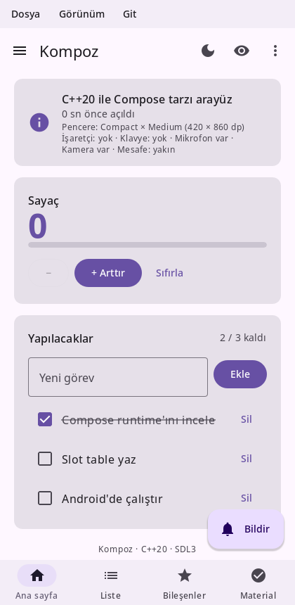
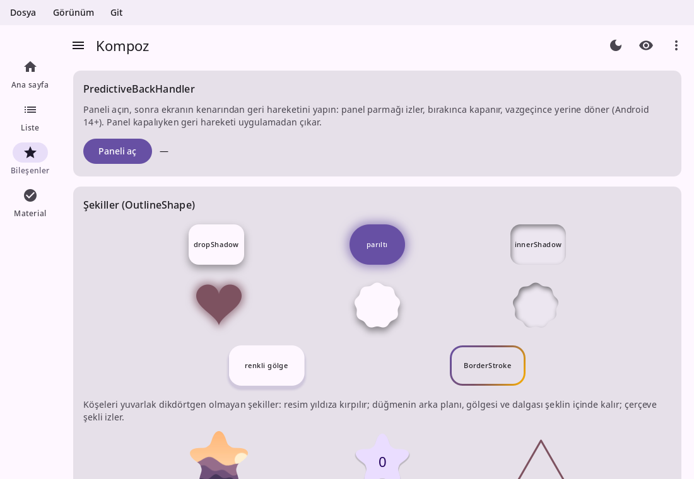
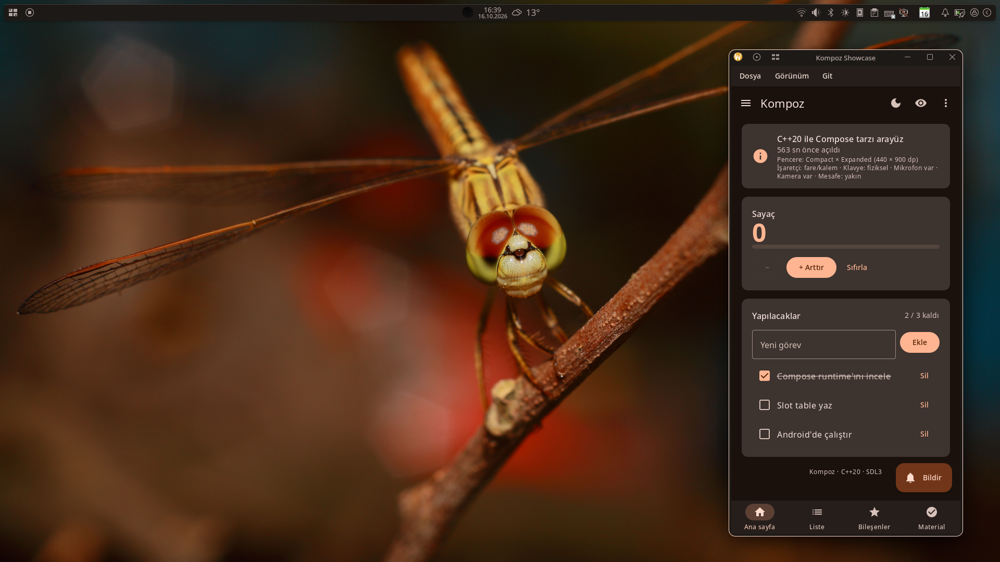
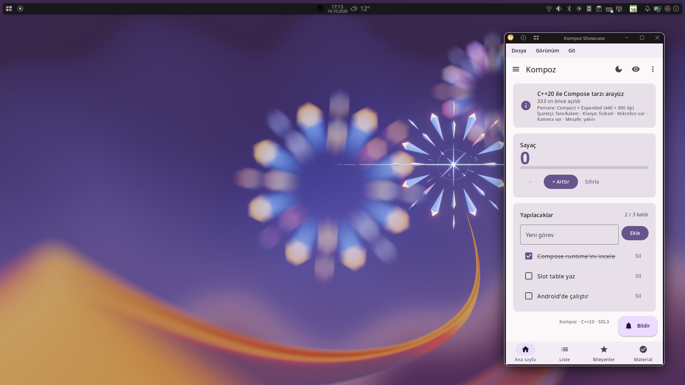

# Kompoz documentation

Kompoz is a declarative UI library for C++20 in the style of Jetpack Compose, with Material 3 components, running on Linux, Windows, macOS, Android and the web from one codebase.

If you know Compose, you know Kompoz: the same way of thinking (composable functions, state, recomposition, modifiers), the same names, and the same way of writing it. A composable is a `@Kompozable fun` in Kotlin's syntax, written in a `.cpp` file; Kompoz's compiler, kompozc, turns it into C++ as the build goes, the way Compose's compiler plugin rewrites Kotlin, and everything around it is C++. Kompoz 0.1.1 is licensed under the Apache License 2.0.



```kotlin
@Kompozable
fun Counter() {
    var count by remember { mutableStateOf(0) }

    Column(modifier = Modifier.padding(16.dp), verticalArrangement = Arrangement.spacedBy(8.dp)) {
        Text("Count: $count", style = MaterialTheme.typography.titleLarge)
        Button(onClick = { count++ }) { Text("Add") }
    }
}

kompoz::Application kompoz::createApplication(int, char**) {
    return {.title = "Demo", .content = [] { MaterialTheme(lightColorScheme(), [] { Counter(); }); }};
}
```

The composable is Kotlin, the entry point below it C++. In the Kotlin a semicolon at the end of a statement is optional, as in Kotlin: `Text("…");` and `Text("…")` read the same, so write it out of a C++ habit or leave it off.

## Get started

- [Setup](setup.md): build Kompoz, add it to your CMake project with `kompozable`, and run on each platform.
- [Tutorial](tutorial.md): build a first app step by step, from a line of text to a Material list.
- [Coming from Compose](coming-from-compose.md): Kotlin code in `.cpp` files, what kompozc reads, and the C++ around it.
- [Writing in C++](cpp.md): Kompoz's composables written in C++ itself, without kompozc.

## Foundation

- [Thinking in Kompoz](thinking.md): declarative UI, composable functions and recomposition.
- [State](state.md): observable state, `remember`, `rememberSaveable`, hoisting and state holders.
- [Lifecycle and identity](lifecycle.md): how calls are identified, and what makes them skip.
- [Side effects](side-effects.md): coroutines, `LaunchedEffect`, `DisposableEffect` and the other effect APIs.
- [Phases](phases.md): composition, layout and drawing, and how to keep each one cheap.
- [KompozitionLocal](kompozition-local.md): handing values down the tree, and the built-in locals.

## Design

- [Modifiers](modifiers.md): decorating composables, why order matters, and writing your own.
- [Layouts](layouts.md): `Column`, `Row`, `Box`, flow layouts, `FlexBox`, `Grid` and adaptive layouts.
- [Custom layouts](custom-layouts.md): `Layout`, constraints, intrinsics and `SubkompozLayout`.
- [Lists and grids](lists.md): lazy lists and grids, pagers, carousels and nested scrolling.
- [Material components](material.md): a tour of the Material 3 components.
- [Theming](theming.md): color schemes, dark theme, dynamic color, typography and design systems.
- [Text](text.md): styling text, fonts, selection and text fields.
- [Graphics](graphics.md): `Canvas`, brushes, paths, shapes, shadows, images and vectors.
- [Animation](animation.md): animated values, visibility, content, transitions and shared elements.
- [Gestures and input](gestures.md): clicks, drags, pinches, the keyboard, focus and drag and drop.

## App

- [Architecture](architecture.md): unidirectional data flow, `ViewModel`s, flows and saved state.
- [Navigation](navigation.md): screens, the back stack, typed routes and deep links.
- [Resources](resources.md): assets, the library's texts in the system language, and platform services.
- [Accessibility](accessibility.md): semantics, screen readers, touch targets and the keyboard.
- [Testing](testing.md): headless UI tests with a virtual clock.
- [Tools](tools.md): previews, rebuilding on save, scripted screenshots and profiling.

## Reference

- [API status](api.md): every Compose API and its status in Kompoz, and the build log.







To see [more](dynamic_color_gallery.md)
