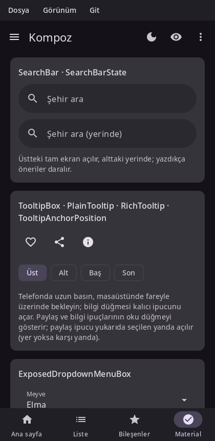

# Material components

Kompoz implements Material 3 as Compose Material 3 1.4 does, Expressive components included: the same components, the same measurements and the same defaults. This page is a tour of the main ones; [the API page](api.md) lists them all with their status.



Material components read their colors, type and motion from `MaterialTheme`, so wrap your app in one. See [Theming](theming.md).

## Scaffold and app bars

`Scaffold` lays out a screen: a top bar, a bottom bar, a floating action button and a snackbar host around the content. The content gets the padding that keeps it clear of the bars and the system's insets.

```kotlin
@Composable
fun Inbox() {
    val snackbars = remember { SnackbarHostState() }
    val scope = rememberCoroutineScope()
    Scaffold(
        topBar = {
            TopAppBar(
                title = { Text("Inbox") },
                navigationIcon = { IconButton(onClick = { }) { Icon(Icons.Filled.Menu, contentDescription = "Menu") } },
                actions = { IconButton(onClick = { }) { Icon(Icons.Filled.Search, contentDescription = "Search") } },
            )
        },
        floatingActionButton = {
            FloatingActionButton(onClick = { scope.launch { snackbars.showSnackbar("Draft saved") } }) {
                Icon(Icons.Filled.Edit, contentDescription = "Compose")
            }
        },
        snackbarHost = { SnackbarHost(snackbars) },
    ) { padding ->
        LazyColumn(modifier = Modifier.fillMaxSize(), contentPadding = padding) {
            items(30) { i -> ListItem(headlineContent = { Text("Message $i") }) }
        }
    }
}
```

Top app bars come in the sizes Material defines: `TopAppBar`, `CenterAlignedTopAppBar`, `MediumTopAppBar` and `LargeTopAppBar`. With a scroll behavior (`TopAppBarDefaults.enterAlwaysScrollBehavior()`, `exitUntilCollapsedScrollBehavior()`, `pinnedScrollBehavior()`) and the behavior's `nestedScrollConnection` on the `Scaffold`, they collapse and change color as the content scrolls (see [Lists and grids](lists.md#nested-scrolling)). `BottomAppBar` and `BottomSheetScaffold` exist too.

The content's padding follows the bars as they change size, a top bar collapsing as the list scrolls, without composing the content again: `Modifier.padding`, `consumeWindowInsets` and the `contentPadding` of lists, pagers and carousels read it as they lay out, as in Compose. To read a side yourself, call `calculateTopPadding()` (and `calculateStartPadding()`, `calculateEndPadding()`, `calculateBottomPadding()`; Kompoz's take no layout direction, the padding knows its own): read in a composable, it composes that composable again when the padding changes; read in a layout, it lays that layout out again.

## Navigation

| Component | Use |
|---|---|
| `NavigationBar` + `NavigationBarItem` | Three to five destinations at the bottom of a phone screen. |
| `ShortNavigationBar` | M3 Expressive's shorter bar. |
| `NavigationRail`, `WideNavigationRail` | Destinations at the side of a wider window. |
| `ModalNavigationDrawer`, `DismissibleNavigationDrawer`, `PermanentNavigationDrawer` | A drawer of destinations. |
| `NavigationSuiteScaffold` | Picks a bar, a rail or a drawer by the window's size. |
| `PrimaryTabRow`, `SecondaryTabRow`, `PrimaryScrollableTabRow` + `Tab` | Tabs. |

`NavigationSuiteScaffold` is usually the one you want: it shows a bar on a phone and a rail on a tablet or desktop window, as Compose's adaptive navigation suite does. Its `navigationSuiteItems` block adds an `item` per destination:

```kotlin
@Composable
fun App() {
    var tab by rememberSaveable { mutableStateOf(0) }
    NavigationSuiteScaffold(
        navigationSuiteItems = {
            item(selected = tab == 0, onClick = { tab = 0 }, icon = { Icon(Icons.Filled.Home, contentDescription = null) }, label = { Text("Home") })
            item(selected = tab == 1, onClick = { tab = 1 }, icon = { Icon(Icons.Filled.Search, contentDescription = null) }, label = { Text("Search") })
            item(selected = tab == 2, onClick = { tab = 2 }, icon = { Icon(Icons.Filled.Settings, contentDescription = null) }, label = { Text("Settings") })
        },
    ) {
        Text("Tab $tab")
    }
}
```

For moving between screens with a back stack, see [Navigation](navigation.md).

## Buttons

| Component | Emphasis |
|---|---|
| `Button` | Filled: the main action. |
| `FilledTonalButton` | Tonal: an important action that isn't the main one. |
| `ElevatedButton`, `OutlinedButton` | Medium emphasis. |
| `TextButton` | Low emphasis, in dialogs and cards. |
| `IconButton`, `FilledIconButton`, `OutlinedIconButton`, `IconToggleButton`… | An icon on its own. |
| `FloatingActionButton`, `SmallFloatingActionButton`, `LargeFloatingActionButton`, `ExtendedFloatingActionButton` | The screen's primary action. |
| `SingleChoiceSegmentedButtonRow` + `SegmentedButton` | A choice among a few options. |
| `ButtonGroup`, `SplitButtonLayout`, `ToggleButton` | M3 Expressive's groups, split buttons and toggles. |

```kotlin body
var view by remember { mutableStateOf(0) }
Row(horizontalArrangement = Arrangement.spacedBy(8.dp)) {
    Button(onClick = { }) { Text("Save") }
    OutlinedButton(onClick = { }) { Text("Cancel") }
    IconButton(onClick = { }) { Icon(Icons.Filled.Favorite, contentDescription = "Like") }
}
SingleChoiceSegmentedButtonRow {
    val labels = listOf("Day", "Week", "Month")
    for (i in 0 until 3) {
        SegmentedButton(selected = view == i, onClick = { view = i }, shape = SegmentedButtonDefaults.itemShape(i, 3)) { Text(labels[i]) }
    }
}
```

M3 Expressive's toggle buttons, button groups and split buttons take Compose's names too: `ToggleButton(checked = …, onCheckedChange = …) { }`, a connected `ButtonGroup { Button(modifier = Modifier.animateWidth(interactionSource)) { } }`, a group from items whose rest goes into a menu, and `SplitButtonLayout(leadingButton = { }, trailingButton = { })`:

```kotlin body
var bold by remember { mutableStateOf(false) }
ButtonGroup(overflowIndicator = { menu -> IconButton(onClick = { if (menu.isExpanded) menu.dismiss() else menu.show() }) { Icon(Icons.Filled.MoreVert, contentDescription = "More") } }) {
    clickableItem(onClick = { }, label = "Copy")
    toggleableItem(checked = bold, onCheckedChange = { bold = it }, label = "Bold")
    clickableItem(onClick = { }, label = "Share", icon = { Icon(Icons.Filled.Share, contentDescription = null) })
}
```

## Cards and lists

`Card`, `ElevatedCard` and `OutlinedCard` group related content; each also comes in a clickable form with `onClick`. `ListItem` is a one-, two- or three-line row with optional leading and trailing content:

```kotlin body
OutlinedCard(modifier = Modifier.fillMaxWidth()) {
    ListItem(
        headlineContent = { Text("Wi-Fi") },
        supportingContent = { Text("Connected") },
        leadingContent = { Icon(Icons.Filled.Settings, contentDescription = null) },
        trailingContent = { Switch(checked = true, onCheckedChange = { }) },
    )
}
```

## Selection controls

`Checkbox`, `TriStateCheckbox`, `RadioButton`, `Switch`, `Slider` and `RangeSlider`. They are stateless: they show the value you pass and report changes through a callback.

```kotlin
@Composable
fun Volume() {
    var volume by remember { mutableStateOf(0.5f) }
    var muted by remember { mutableStateOf(false) }
    Column {
        Slider(value = volume, onValueChange = { volume = it })
        Row(
            modifier = Modifier.toggleable(value = muted, onValueChange = { muted = it }, role = Role.Checkbox),
            verticalAlignment = Alignment.CenterVertically,
        ) {
            Checkbox(checked = muted, onCheckedChange = null)   // the whole row toggles it
            Text("Mute")
        }
    }
}
```

Pass `null` as the callback of a control inside a row that handles the click itself, as above, so that the row is one touch target and one item for accessibility.

## Chips

`AssistChip`, `FilterChip`, `InputChip` and `SuggestionChip`, with `label`, `leadingIcon`, `trailingIcon` and `enabled` as in Compose (and the elevated ones):

```kotlin body
var unread by remember { mutableStateOf(false) }
FilterChip(selected = unread, onClick = { unread = !unread }, label = { Text("Unread") })
AssistChip(onClick = { }, label = { Text("Help") }, leadingIcon = { Icon(Icons.Filled.Info, contentDescription = null, modifier = Modifier.size(18.dp)) })
```

## Text fields

`TextField` and `OutlinedTextField`, with labels, placeholders, icons, prefixes, suffixes, supporting text and errors; `SearchBar` and `DockedSearchBar` for search. See [Text](text.md#text-fields).

## Dialogs, sheets and menus

These show above the rest of the UI. Each is composed where you call it, so it keeps its state and composition locals, and Kompoz places it on top. Show one by calling it while a state says so:

```kotlin
@Composable
fun DeleteButton(onDelete: () -> Unit) {
    var open by remember { mutableStateOf(false) }
    TextButton(onClick = { open = true }) { Text("Delete") }
    if (open) {
        AlertDialog(
            onDismissRequest = { open = false },
            confirmButton = { TextButton(onClick = { open = false; onDelete() }) { Text("Delete") } },
            dismissButton = { TextButton(onClick = { open = false }) { Text("Cancel") } },
            title = { Text("Delete this message?") },
            text = { Text("It will be gone for good.") },
        )
    }
}
```

| Component | Use |
|---|---|
| `AlertDialog`, `BasicAlertDialog`, `Dialog` | Asks for a decision. |
| `ModalBottomSheet` | Content that slides up from the bottom, dismissed by dragging it down. |
| `DropdownMenu` + `DropdownMenuItem` | A menu anchored to what opened it. |
| `ExposedDropdownMenuBox` | A text field with a menu of choices. |
| `DatePicker`, `DateRangePicker`, `TimePicker`, `TimeInput` | Dates and times, alone or in `DatePickerDialog` / `TimePickerDialog`. |
| `TooltipBox` + `PlainTooltip` / `RichTooltip` | A hint on long press or hover. |

## Snackbars

A `SnackbarHost` shows the messages of a `SnackbarHostState`. `showSnackbar` suspends until the snackbar is gone and tells how it went, so call it in a coroutine, as in Compose (from a plain callback it only shows the message):

```kotlin body
#! fun undo() {}
val snackbars = remember { SnackbarHostState() }
val scope = rememberCoroutineScope()
Button(onClick = {
    scope.launch {
        if (snackbars.showSnackbar("Message deleted", actionLabel = "Undo") == SnackbarResult.ActionPerformed) undo()
    }
}) { Text("Delete") }
SnackbarHost(hostState = snackbars)
```

## Progress

`CircularProgressIndicator` and `LinearProgressIndicator`, with a `progress` lambda or without one (indeterminate); M3 Expressive's `LoadingIndicator`, `ContainedLoadingIndicator` and the wavy indicators. Indeterminate indicators animate in the draw phase, so they don't recompose anything.

```kotlin body
#! val progress = 0.4f
CircularProgressIndicator()                      // indeterminate
LinearProgressIndicator(progress = { progress }) // 40 %
```

## Other components

Badges (`BadgedBox`, `Badge`), dividers (`HorizontalDivider`, `VerticalDivider`), carousels (see [Lists and grids](lists.md#carousels)), pull to refresh, swipe to dismiss (`SwipeToDismissBox`), floating toolbars, and more. The [API page](api.md) has the complete list.

## See also

- [Theming](theming.md): colors, typography and dark theme.
- [Navigation](navigation.md): screens and the back stack.
- [Text](text.md): text fields in depth.
