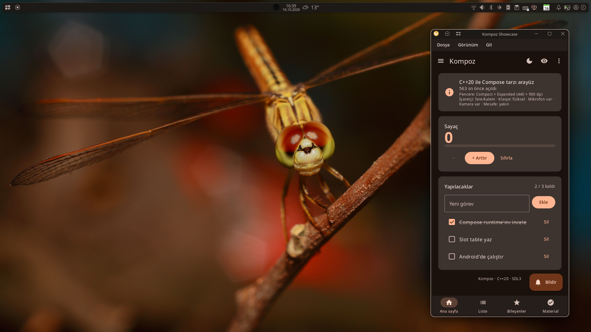
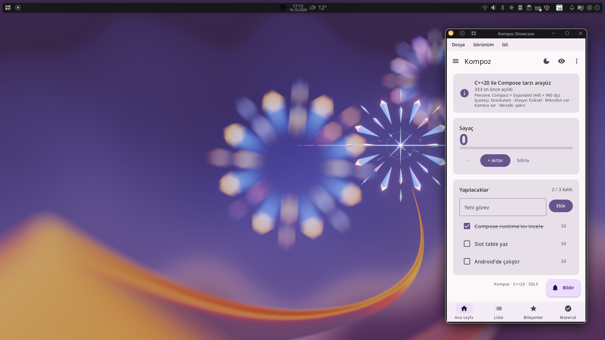

# Theming

`MaterialTheme` gives everything inside it Material 3's color scheme, typography and motion. This page covers color schemes, dark theme, dynamic color from the wallpaper or the desktop's accent color, typography, and building a design system of your own.

## MaterialTheme

Wrap your app's content in `MaterialTheme`, usually once at the top:

```kotlin
#! @Kompozable fun App() {}
@Kompozable
fun ThemedApp() {
    val dark = isSystemInDarkTheme()
    MaterialTheme(colorScheme = if (dark) darkColorScheme() else lightColorScheme()) {
        App()
    }
}

kompoz::Application kompoz::createApplication(int, char**) {
    return {.title = "Themed", .content = [] { ThemedApp(); }};
}
```

Components read the theme through composition locals. Read it yourself with `MaterialTheme.colorScheme`, `MaterialTheme.typography` and `MaterialTheme.motionScheme`:

```kotlin
@Kompozable
fun Tag(text: String) {
    Text(
        text,
        modifier = Modifier.background(MaterialTheme.colorScheme.secondaryContainer, RoundedCornerShape(8.dp)).padding(horizontal = 8.dp, vertical = 4.dp),
        color = MaterialTheme.colorScheme.onSecondaryContainer,
        style = MaterialTheme.typography.labelMedium,
    )
}
```

`MaterialExpressiveTheme` is the same with M3 Expressive's springier motion scheme.

## Color schemes

A `ColorScheme` has all of Material 3's color roles, as Compose 1.4's: `primary`, `onPrimary`, `primaryContainer`, `secondary`, `tertiary`, `error`, the surfaces (`surface`, `surfaceContainerLowest` … `surfaceContainerHighest`, `surfaceBright`, `surfaceDim`), `outline`, `inverseSurface`, the fixed colors and more.

- `lightColorScheme()` and `darkColorScheme()` are Material's baseline purple schemes.
- Each `on…` color is the color for content on the matching container: `onPrimary` on `primary`, `onSurface` on `surface`. `contentColorFor(background)` finds it for you.
- Material containers (`Surface`, `Card`, buttons) set `LocalContentColor` to their content color, so `Text` and `Icon` inside them get the right color without being told.

A scheme of your own is a `ColorScheme` with its fields set. Start from a baseline and change what you need:

```kotlin
fun brandColors(dark: Boolean): ColorScheme =
    if (dark) darkColorScheme(primary = Color(0xFF9ECAFF), onPrimary = Color(0xFF003258))
    else lightColorScheme(primary = Color(0xFF0061A4), onPrimary = Color.White)
```

### From one color

`TonalPalette.fromSeed(color)` makes the five tonal palettes Material You derives from one color, the way Android 13 does from the wallpaper (its "tonal spot" style), in Material's HCT color space. `dynamicLightColorScheme(palette)` and `dynamicDarkColorScheme(palette)` turn them into schemes with Material's tone mapping:

```kotlin
val BrandPalette = TonalPalette.fromSeed(Color(0xFF00796B))

@Kompozable
fun BrandTheme(content: @Kompozable () -> Unit) {
    val dark = isSystemInDarkTheme()
    MaterialTheme(colorScheme = if (dark) dynamicDarkColorScheme(BrandPalette) else dynamicLightColorScheme(BrandPalette), content = content)
}
```

This is the easiest way to a complete, consistent scheme from a brand color. `Hct.fromColor(c)` and `Hct(hue, chroma, tone).toColor()` work in the HCT color space directly.

## Dark theme

`isSystemInDarkTheme()` follows the system's dark mode, and changes while the app runs: from Android's setting, from the XDG desktop portal on Linux, from the browser on the web. Pick the scheme by it, as above.

On Android, tell the system bars whether to draw light or dark icons with `SystemBarsAppearance`: dark icons over a light theme.

```kotlin
#! @Kompozable fun App() {}
@Kompozable
fun Root() {
    val dark = isSystemInDarkTheme()
    SystemBarsAppearance(!dark)
    MaterialTheme(colorScheme = if (dark) darkColorScheme() else lightColorScheme()) { App() }
}
```

To let the user choose, keep the choice in state and fall back to the system's:

```kotlin
#! @Kompozable fun App() {}
enum class ThemeChoice { System, Light, Dark }

@Kompozable
fun Root(choice: ThemeChoice) {
    val dark = when (choice) {
        ThemeChoice.System -> isSystemInDarkTheme()
        ThemeChoice.Dark -> true
        else -> false
    }
    MaterialTheme(colorScheme = if (dark) darkColorScheme() else lightColorScheme()) { App() }
}
```

## Dynamic color




A theme's colors can come from three places, and Kompoz offers each as an API of its own. Which one an app uses is the app's decision, or its user's: Kompoz never switches from one to another by itself.

| Source | Schemes | Where it is available |
|---|---|---|
| The app's own colors | `lightColorScheme()`, `darkColorScheme()`, or a scheme of your own (`TonalPalette.fromSeed` of a brand color) | Everywhere. |
| The system's palette | `dynamicLightColorScheme()`, `dynamicDarkColorScheme()`; `isDynamicColorAvailable()` | Android 12+ (the palette the system made, from the wallpaper or the colors the user picked); Linux desktops that give an accent color through the XDG portal (on KDE, the color scheme's accent); Windows 10 and 11 (the accent color in Settings > Personalization > Colors). |
| The wallpaper itself | `wallpaperLightColorScheme()`, `wallpaperDarkColorScheme()`; `isWallpaperColorAvailable()` | Linux (KDE Plasma; GNOME, Cinnamon and MATE; Xfce), Windows, Android 8.1+. |

The system's palette follows what the user chose in the system's settings, so an app that uses it matches the rest of the desktop. The wallpaper's colors are picked from the picture itself the way Android picks them (`TonalPalette.fromImage`), also on desktops whose own colors don't follow the wallpaper. On Android, where apps can't see the colors' populations, the seed is the first of the system's main wallpaper colors that isn't grey, as System UI takes it in that case. Both update while the app runs, when the wallpaper, the accent color or the theme changes; where a source has nothing, its schemes are the baseline ones, so an app can always fall back to its own colors.

Let the user choose, and keep the choice:

```kotlin
#! @Kompozable fun App() {}
enum class ColorSource { App, System, Wallpaper }

@Kompozable
fun Root(source: ColorSource) {
    val dark = isSystemInDarkTheme()
    val scheme = when {
        source == ColorSource.System && isDynamicColorAvailable() -> if (dark) dynamicDarkColorScheme() else dynamicLightColorScheme()
        source == ColorSource.Wallpaper && isWallpaperColorAvailable() -> if (dark) wallpaperDarkColorScheme() else wallpaperLightColorScheme()
        else -> if (dark) darkColorScheme() else lightColorScheme()
    }
    MaterialTheme(colorScheme = scheme) { App() }
}
```

The showcase asks this way, in its View menu and on its Material screen.

### Colors from any picture

`TonalPalette.fromImage(bitmap)` makes Material You's palettes from any picture, as the wallpaper's are made: an album's cover, a profile photo. It does what Android does with a wallpaper: the picture scaled to at most 112 × 112 of area without filtering, as `WallpaperColors` scales it; `quantizeColors(bitmap)` finds the colors it is made of and how much of each (the Celebi quantizer Android and Material Color Utilities use); `seedColors(colors)` ranks those that would make good theme seeds as Android's System UI ranks a wallpaper's, up to four, so you can offer the user a choice of seeds as Android's wallpaper picker does:

```kotlin
@Kompozable
fun CoverTheme(cover: ImageBitmap, content: @Kompozable () -> Unit) {
    val palette = remember(cover) { TonalPalette.fromImage(cover) }   // once per picture
    MaterialTheme(colorScheme = if (isSystemInDarkTheme()) dynamicDarkColorScheme(palette) else dynamicLightColorScheme(palette), content = content)
}
```

`KOMPOZ_NO_DESKTOP_ACCENT=1` and `KOMPOZ_NO_WALLPAPER_COLORS=1` leave out the desktop's accent color and the wallpaper's colors, for screenshots that are the same on every machine.

## Animating a theme change

`ColorScheme.map` applies a function to every color. With `animateColorAsState`, each color animates to its new value when the scheme changes (a `@Kompozable fun` that returns a value is a group of its own, as in Compose, so its animations keep their identity):

```kotlin
#! @Kompozable fun App() {}
@Kompozable
fun animateColorScheme(target: ColorScheme): ColorScheme = target.map { animateColorAsState(it, 400) }

@Kompozable
fun Root(dark: Boolean) {
    MaterialTheme(colorScheme = animateColorScheme(if (dark) darkColorScheme() else lightColorScheme())) { App() }
}
```

Each `animateColorAsState` call inside `map` runs in the same order every time, so each color keeps its own animation.

## Typography

`Typography` holds Material 3's type scale: `displayLarge`, `displayMedium`, `displaySmall`, `headlineLarge` … `headlineSmall`, `titleLarge` … `titleSmall`, `bodyLarge` … `bodySmall` and `labelLarge` … `labelSmall`. Each is a `Font` (Compose's `TextStyle`): a size in sp, a weight, a letter spacing and a line height. Use them through `MaterialTheme.typography`:

```kotlin body
Text("Settings", style = MaterialTheme.typography.headlineSmall)
Text("Notifications are on", style = MaterialTheme.typography.bodyMedium)
```

To change the type scale, provide your own `Typography` through `LocalTypography`:

```kotlin
val Lora = FontFamily.fromFiles(listOf(FontFile("fonts/Lora-Regular.ttf"), FontFile("fonts/Lora-Bold.ttf", FontWeight.Bold)))

@Kompozable
fun BrandTypography(content: @Kompozable () -> Unit) {
    val base = MaterialTheme.typography
    val type = base.copy(
        displayLarge = base.displayLarge.copy(fontFamily = Lora),
        headlineLarge = base.headlineLarge.copy(fontFamily = Lora),
        headlineMedium = base.headlineMedium.copy(fontFamily = Lora),
    )
    MaterialTheme(typography = type, content = content)
}
```

`copy(fontFamily = …, fontWeight = …, fontSize = …)` changes a style, as Compose's `TextStyle.copy`; `Typography(displayLarge = …)` and `typography.copy(…)` a type scale. Font files are assets (see [Resources](resources.md)); `FontFamily.fromFiles` is Kompoz's way of making a family from them. The generic families `FontFamily.Serif` and `FontFamily.Monospace` use the system's fonts where there are some. Text sizes follow the system's font scale.

## Shapes

Components have Material's shapes built in: a button's full rounding, a card's 12 dp corners, a sheet's 28 dp top corners. There is no theme-wide `Shapes` object to change them all at once; pass a shape where a component takes one, and use `RoundedCornerShape`, `CutCornerShape`, `CircleShape` or the Material shape library (`MaterialShapes`) for your own.

## A design system of your own

When your app doesn't follow Material, build your own theme the same way `MaterialTheme` is built: put the tokens in a data class, provide it through a `KompozitionLocal`, and read it where it is needed:

```kotlin
data class BrandColors(val accent: Color, val background: Color, val text: Color)

val LocalBrandColors = staticKompozitionLocalOf { BrandColors(Color(0xFFFF5722), Color.White, Color(0xFF212121)) }

@Kompozable
fun BrandTheme(colors: BrandColors, content: @Kompozable () -> Unit) {
    KompozitionLocalProvider(LocalBrandColors provides colors, LocalContentColor provides colors.text, content = content)
}

@Kompozable
fun BrandButton(label: String, onClick: () -> Unit) {
    val brand = LocalBrandColors.current
    Box(modifier = Modifier.clickable { onClick() }.background(brand.accent, RoundedCornerShape(8.dp)).padding(horizontal = 16.dp, vertical = 10.dp)) {
        Text(label, color = brand.background)
    }
}
```

You can mix both: keep `MaterialTheme` for Material components and add your own locals for what Material doesn't cover.

## See also

- [KompozitionLocal](kompozition-local.md): how themes reach components.
- [Material components](material.md): what the theme styles.
- [Text](text.md): fonts and text styles.
