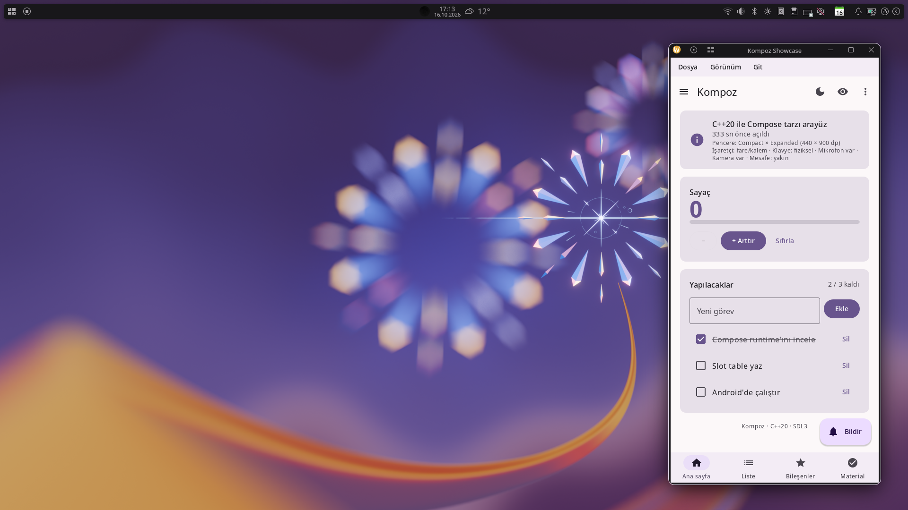

# Kompoz belgeleri

Kompoz, C++20 için Jetpack Compose tarzında deklaratif bir arayüz kütüphanesidir; Material 3 bileşenleriyle gelir ve tek kod tabanından Linux, Windows, Android ve web'de çalışır.

Compose'u biliyorsanız Kompoz'u da biliyorsunuz: aynı düşünme biçimi (composable fonksiyonlar, durum, recomposition, modifier'lar), C++'ın izin verdiği yerde aynı isimler ve Compose'unkiler gibi görünen ve davranan Material 3 bileşenleri. Sürüm 0.1.0 ilk açık yayındır ve Apache Lisansı 2.0 ile lisanslıdır.


```cpp
void Counter() {
    auto count = remember([] { return mutableStateOf(0); });

    Column(Modifier().padding(16), {.verticalArrangement = Arrangement::spacedBy(8)}, [&] {
        Text("Count: " + std::to_string(count.get()), {.font = typography().titleLarge});
        Button([count] { count.set(count.get() + 1); }, [] { Text("Add"); });
    });
}

Application kompoz::createApplication(int, char**) {
    return {.title = "Demo", .content = [] { MaterialTheme(lightColorScheme(), Counter); }};
}
```

## Başlarken

- [Kurulum](setup.md): Kompoz'u derleyin, kendi CMake projenize ekleyin ve her platformda çalıştırın.
- [Eğitim](tutorial.md): tek satır metinden bir Material listesine, ilk uygulamayı adım adım kurun.
- [Compose'dan gelenler için](coming-from-compose.md): Kotlin'deki Compose'un C++'a nasıl karşılık geldiği, bir bakışta.

## Temeller

- [Kompoz'da düşünmek](thinking.md): deklaratif arayüz, composable fonksiyonlar ve recomposition.
- [Durum](state.md): gözlemlenebilir durum, `remember`, `rememberSaveable`, durumu yukarı taşıma ve durum tutucular.
- [Yaşam döngüsü ve kimlik](lifecycle.md): çağrıların bir compiler plugin olmadan nasıl tanındığı ve neyin onları atlattığı.
- [Yan etkiler](side-effects.md): coroutine'ler, `LaunchedEffect`, `DisposableEffect` ve diğer efekt API'leri.
- [Aşamalar](phases.md): kompozisyon, yerleşim ve çizim; her birini nasıl ucuz tutacağınız.
- [CompositionLocal](composition-local.md): değerleri ağaçta aşağı aktarmak ve yerleşik local'ler.

## Tasarım

- [Modifier'lar](modifiers.md): composable'ları süslemek, sıranın neden önemli olduğu ve kendi modifier'ınızı yazmak.
- [Yerleşimler](layouts.md): `Column`, `Row`, `Box`, akan yerleşimler, `FlexBox`, `Grid` ve uyarlanabilir yerleşimler.
- [Özel yerleşimler](custom-layouts.md): `Layout`, kısıtlar, intrinsic'ler ve `SubcomposeLayout`.
- [Listeler ve ızgaralar](lists.md): tembel listeler ve ızgaralar, pager'lar, carousel'ler ve iç içe kaydırma.
- [Material bileşenleri](material.md): Material 3 bileşenlerinde bir tur.
- [Tema](theming.md): renk şemaları, koyu tema, dinamik renk, tipografi ve tasarım sistemleri.
- [Metin](text.md): metne stil vermek, fontlar, seçim ve metin alanları.
- [Grafik](graphics.md): `Canvas`, fırçalar, path'ler, şekiller, gölgeler, resimler ve vektörler.
- [Animasyon](animation.md): animasyonlu değerler, görünürlük, içerik, geçişler ve paylaşılan öğeler.
- [Hareketler ve girdi](gestures.md): tıklamalar, sürüklemeler, iki parmakla yakınlaştırma, klavye, odak ve sürükle-bırak.

## Uygulama

- [Mimari](architecture.md): tek yönlü veri akışı, `ViewModel`'ler, flow'lar ve kaydedilen durum.
- [Gezinme](navigation.md): ekranlar, geri yığını, tür güvenli rotalar ve derin bağlantılar.
- [Kaynaklar](resources.md): varlıklar (asset'ler), kütüphanenin sistem dilindeki metinleri ve platform servisleri.
- [Erişilebilirlik](accessibility.md): semantik, ekran okuyucular, dokunma hedefleri ve klavye.
- [Test](testing.md): sanal saatle, pencere açmadan arayüz testleri.
- [Araçlar](tools.md): önizlemeler, kaydedince yeniden derleme, betikle ekran görüntüleri ve profil çıkarma.

## Başvuru

- [API durumu](api.md): her Compose API'si ve Kompoz'daki durumu, ayrıca geliştirme günlüğü.




[Daha fazlasını](../../screenshots/dynamic-color-linux/) görmek için
