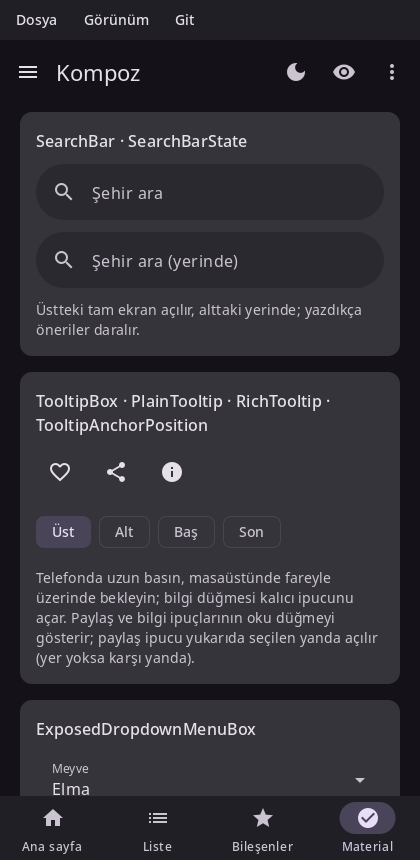

# Material bileşenleri

Kompoz, Material 3'ü Compose Material 3 1.4'ün yaptığı gibi, Expressive bileşenler dahil uygular: aynı bileşenler, aynı ölçüler ve aynı varsayılanlar. Bu sayfa başlıcalarını gezdiriyor; hepsini durumlarıyla birlikte [API sayfası](api.md) listeliyor.



Material bileşenleri renklerini, yazı tiplerini ve hareketlerini `MaterialTheme`'den okur, bu yüzden uygulamanızı bir `MaterialTheme`'e sarın. Bkz. [Tema](theming.md).

## Scaffold ve uygulama çubukları

`Scaffold` bir ekranı yerleştirir: içeriğin çevresinde bir üst çubuk, bir alt çubuk, bir yüzen eylem butonu ve bir snackbar host'u. İçerik, onu çubuklardan ve sistemin kenar boşluklarından uzak tutan iç boşluğu alır.

```kotlin
@Composable
fun Inbox() {
    val snackbars = remember { SnackbarHostState() }
    val scope = rememberCoroutineScope()
    Scaffold(
        topBar = {
            TopAppBar(
                title = { Text("Inbox") },
                navigationIcon = { IconButton(onClick = { }) { Icon(Icons.Filled.Menu, contentDescription = "Menu") } },
                actions = { IconButton(onClick = { }) { Icon(Icons.Filled.Search, contentDescription = "Search") } },
            )
        },
        floatingActionButton = {
            FloatingActionButton(onClick = { scope.launch { snackbars.showSnackbar("Draft saved") } }) {
                Icon(Icons.Filled.Edit, contentDescription = "Compose")
            }
        },
        snackbarHost = { SnackbarHost(snackbars) },
    ) { padding ->
        LazyColumn(modifier = Modifier.fillMaxSize(), contentPadding = padding) {
            items(30) { i -> ListItem(headlineContent = { Text("Message $i") }) }
        }
    }
}
```

Üst uygulama çubukları Material'ın tanımladığı boyutlarda gelir: `TopAppBar`, `CenterAlignedTopAppBar`, `MediumTopAppBar` ve `LargeTopAppBar`. Bir kaydırma davranışıyla (`TopAppBarDefaults.enterAlwaysScrollBehavior()`, `exitUntilCollapsedScrollBehavior()`, `pinnedScrollBehavior()`) ve bu davranışın `nestedScrollConnection`'ı `Scaffold`'a verildiğinde, içerik kaydıkça daralır ve renk değiştirirler (bkz. [Listeler ve ızgaralar](lists.md#iç-içe-kaydırma)). `BottomAppBar` ve `BottomSheetScaffold` da var.

İçeriğin iç boşluğu, çubukların boyu değiştikçe (liste kaydıkça daralan bir üst çubuk) içerik yeniden oluşturulmadan onları izler: Compose'taki gibi `Modifier.padding`, `consumeWindowInsets` ve listelerin, pager'ların, carousel'lerin `contentPadding`'i onu yerleşim sırasında okur. Bir kenarı kendiniz okumak için `calculateTopPadding()` (ve `calculateStartPadding()`, `calculateEndPadding()`, `calculateBottomPadding()`; Kompoz'unkiler yerleşim yönü almaz, iç boşluk kendininkini bilir) çağırın. Bir composable'da okunursa iç boşluk değiştiğinde o composable yeniden oluşturulur; bir yerleşimde okunursa o yerleşim yeniden yerleştirilir.

## Gezinme

| Bileşen | Kullanım |
|---|---|
| `NavigationBar` + `NavigationBarItem` | Telefon ekranının altında üç ile beş arası hedef. |
| `ShortNavigationBar` | M3 Expressive'in daha kısa çubuğu. |
| `NavigationRail`, `WideNavigationRail` | Daha geniş bir pencerenin yanında hedefler. |
| `ModalNavigationDrawer`, `DismissibleNavigationDrawer`, `PermanentNavigationDrawer` | Hedeflerden oluşan bir çekmece. |
| `NavigationSuiteScaffold` | Pencerenin boyutuna göre bir çubuk, bir ray ya da bir çekmece seçer. |
| `PrimaryTabRow`, `SecondaryTabRow`, `PrimaryScrollableTabRow` + `Tab` | Sekmeler. |

Çoğu zaman istediğiniz `NavigationSuiteScaffold`'dur: Compose'un adaptive navigation suite'i gibi telefonda bir çubuk, tablet ya da masaüstü penceresinde bir ray gösterir. `navigationSuiteItems` bloğu her hedef için bir `item` ekler:

```kotlin
@Composable
fun App() {
    var tab by rememberSaveable { mutableStateOf(0) }
    NavigationSuiteScaffold(
        navigationSuiteItems = {
            item(selected = tab == 0, onClick = { tab = 0 }, icon = { Icon(Icons.Filled.Home, contentDescription = null) }, label = { Text("Home") })
            item(selected = tab == 1, onClick = { tab = 1 }, icon = { Icon(Icons.Filled.Search, contentDescription = null) }, label = { Text("Search") })
            item(selected = tab == 2, onClick = { tab = 2 }, icon = { Icon(Icons.Filled.Settings, contentDescription = null) }, label = { Text("Settings") })
        },
    ) {
        Text("Tab $tab")
    }
}
```

Ekranlar arasında bir geri yığınıyla geçiş için bkz. [Gezinme](navigation.md).

## Butonlar

| Bileşen | Vurgu |
|---|---|
| `Button` | Dolgulu: ana eylem. |
| `FilledTonalButton` | Tonal: ana eylem olmayan önemli bir eylem. |
| `ElevatedButton`, `OutlinedButton` | Orta vurgu. |
| `TextButton` | Düşük vurgu, diyaloglarda ve kartlarda. |
| `IconButton`, `FilledIconButton`, `OutlinedIconButton`, `IconToggleButton`… | Tek başına bir ikon. |
| `FloatingActionButton`, `SmallFloatingActionButton`, `LargeFloatingActionButton`, `ExtendedFloatingActionButton` | Ekranın birincil eylemi. |
| `SingleChoiceSegmentedButtonRow` + `SegmentedButton` | Birkaç seçenek arasından bir seçim. |
| `ButtonGroup`, `SplitButtonLayout`, `ToggleButton` | M3 Expressive'in grupları, bölünmüş butonları ve açma/kapama butonları. |

```kotlin body
var view by remember { mutableStateOf(0) }
Row(horizontalArrangement = Arrangement.spacedBy(8.dp)) {
    Button(onClick = { }) { Text("Save") }
    OutlinedButton(onClick = { }) { Text("Cancel") }
    IconButton(onClick = { }) { Icon(Icons.Filled.Favorite, contentDescription = "Like") }
}
SingleChoiceSegmentedButtonRow {
    val labels = listOf("Gün", "Hafta", "Ay")
    for (i in 0 until 3) {
        SegmentedButton(selected = view == i, onClick = { view = i }, shape = SegmentedButtonDefaults.itemShape(i, 3)) { Text(labels[i]) }
    }
}
```

M3 Expressive'in açma/kapama butonları, buton grupları ve bölünmüş butonları da Compose'un adlarını alır: `ToggleButton(checked = …, onCheckedChange = …) { }`, bağlı bir `ButtonGroup { Button(modifier = Modifier.animateWidth(interactionSource)) { } }`, kalanı bir menüye giden öğelerden bir grup ve `SplitButtonLayout(leadingButton = { }, trailingButton = { })`:

```kotlin body
var bold by remember { mutableStateOf(false) }
ButtonGroup(overflowIndicator = { menu -> IconButton(onClick = { if (menu.isExpanded) menu.dismiss() else menu.show() }) { Icon(Icons.Filled.MoreVert, contentDescription = "Daha") } }) {
    clickableItem(onClick = { }, label = "Kopyala")
    toggleableItem(checked = bold, onCheckedChange = { bold = it }, label = "Kalın")
    clickableItem(onClick = { }, label = "Paylaş", icon = { Icon(Icons.Filled.Share, contentDescription = null) })
}
```

## Kartlar ve listeler

`Card`, `ElevatedCard` ve `OutlinedCard` ilgili içeriği gruplar; her birinin `onClick` alan tıklanabilir bir biçimi de vardır. `ListItem`, isteğe bağlı baş ve son içerikli bir, iki ya da üç satırlık bir satırdır:

```kotlin body
OutlinedCard(modifier = Modifier.fillMaxWidth()) {
    ListItem(
        headlineContent = { Text("Wi-Fi") },
        supportingContent = { Text("Connected") },
        leadingContent = { Icon(Icons.Filled.Settings, contentDescription = null) },
        trailingContent = { Switch(checked = true, onCheckedChange = { }) },
    )
}
```

## Seçim kontrolleri

`Checkbox`, `TriStateCheckbox`, `RadioButton`, `Switch`, `Slider` ve `RangeSlider`. Durumsuzdurlar: verdiğiniz değeri gösterir ve değişiklikleri bir geri çağrıyla bildirirler.

```kotlin
@Composable
fun Volume() {
    var volume by remember { mutableStateOf(0.5f) }
    var muted by remember { mutableStateOf(false) }
    Column {
        Slider(value = volume, onValueChange = { volume = it })
        Row(
            modifier = Modifier.toggleable(value = muted, onValueChange = { muted = it }, role = Role.Checkbox),
            verticalAlignment = Alignment.CenterVertically,
        ) {
            Checkbox(checked = muted, onCheckedChange = null)   // onu bütün satır açıp kapatır
            Text("Mute")
        }
    }
}
```

Tıklamayı kendisi işleyen bir satırın içindeki kontrole, yukarıdaki gibi geri çağrı olarak `null` verin; böylece satır tek bir dokunma hedefi ve erişilebilirlik için tek bir öğe olur.

## Chip'ler

`AssistChip`, `FilterChip`, `InputChip` ve `SuggestionChip`, Compose'daki gibi `label`, `leadingIcon`, `trailingIcon` ve `enabled` ile (yükseltilmiş olanları da var):

```kotlin body
var unread by remember { mutableStateOf(false) }
FilterChip(selected = unread, onClick = { unread = !unread }, label = { Text("Unread") })
AssistChip(onClick = { }, label = { Text("Help") }, leadingIcon = { Icon(Icons.Filled.Info, contentDescription = null, modifier = Modifier.size(18.dp)) })
```

## Metin alanları

Etiketli, yer tutuculu, ikonlu, önekli, sonekli, yardımcı metinli ve hatalı `TextField` ve `OutlinedTextField`; arama için `SearchBar` ve `DockedSearchBar`. Bkz. [Metin](text.md#metin-alanları).

## Diyaloglar, alt sayfalar ve menüler

Bunlar arayüzün geri kalanının üstünde görünür. Her biri çağırdığınız yerde kompoze edilir, böylece durumunu ve composition local'larını korur; Kompoz da onu en üste yerleştirir. Birini, bir durum öyle söylediği sürece onu çağırarak gösterin:

```kotlin
@Composable
fun DeleteButton(onDelete: () -> Unit) {
    var open by remember { mutableStateOf(false) }
    TextButton(onClick = { open = true }) { Text("Delete") }
    if (open) {
        AlertDialog(
            onDismissRequest = { open = false },
            confirmButton = { TextButton(onClick = { open = false; onDelete() }) { Text("Delete") } },
            dismissButton = { TextButton(onClick = { open = false }) { Text("Cancel") } },
            title = { Text("Delete this message?") },
            text = { Text("It will be gone for good.") },
        )
    }
}
```

| Bileşen | Kullanım |
|---|---|
| `AlertDialog`, `BasicAlertDialog`, `Dialog` | Bir karar ister. |
| `ModalBottomSheet` | Alttan kayarak açılan, aşağı sürüklenerek kapatılan içerik. |
| `DropdownMenu` + `DropdownMenuItem` | Onu açan öğeye bağlı bir menü. |
| `ExposedDropdownMenuBox` | Seçeneklerden oluşan bir menüsü olan metin alanı. |
| `DatePicker`, `DateRangePicker`, `TimePicker`, `TimeInput` | Tek başına ya da `DatePickerDialog` / `TimePickerDialog` içinde tarihler ve saatler. |
| `TooltipBox` + `PlainTooltip` / `RichTooltip` | Uzun basınca ya da üzerine gelince bir ipucu. |

## Snackbar'lar

Bir `SnackbarHost`, bir `SnackbarHostState`'in mesajlarını gösterir. `showSnackbar`, snackbar gidene kadar askıya alır ve nasıl gittiğini söyler; bu yüzden onu Compose'daki gibi bir coroutine içinde çağırın (düz bir geri çağrıdan yalnızca mesajı gösterir):

```kotlin body
#! fun undo() {}
val snackbars = remember { SnackbarHostState() }
val scope = rememberCoroutineScope()
Button(onClick = {
    scope.launch {
        if (snackbars.showSnackbar("Message deleted", actionLabel = "Undo") == SnackbarResult.ActionPerformed) undo()
    }
}) { Text("Delete") }
SnackbarHost(hostState = snackbars)
```

## İlerleme

Bir `progress` lambdasıyla ya da onsuz (belirsiz) `CircularProgressIndicator` ve `LinearProgressIndicator`; M3 Expressive'in `LoadingIndicator`, `ContainedLoadingIndicator` ve dalgalı göstergeleri. Belirsiz göstergeler çizim aşamasında canlanır, bu yüzden hiçbir şeyi yeniden kompoze etmezler.

```kotlin body
#! val progress = 0.4f
CircularProgressIndicator()                      // belirsiz
LinearProgressIndicator(progress = { progress }) // %40
```

## Diğer bileşenler

Rozetler (`BadgedBox`, `Badge`), ayırıcılar (`HorizontalDivider`, `VerticalDivider`), carousel'ler (bkz. [Listeler ve ızgaralar](lists.md#carouseller)), çekip yenileme, kaydırarak kapatma (`SwipeToDismissBox`), yüzen araç çubukları ve daha fazlası. Tam listesi [API sayfasında](api.md).

## Ayrıca bakın

- [Tema](theming.md): renkler, tipografi ve koyu tema.
- [Gezinme](navigation.md): ekranlar ve geri yığını.
- [Metin](text.md): metin alanları ayrıntısıyla.
