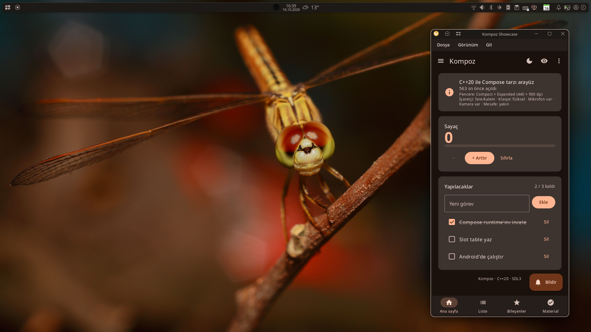
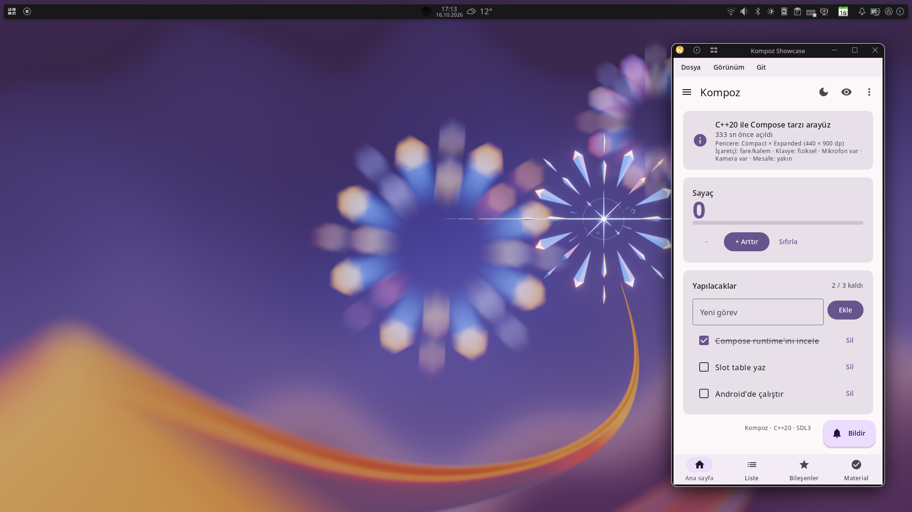

# Tema

`MaterialTheme`, içindeki her şeye Material 3'ün renk şemasını, tipografisini ve hareket şemasını verir. Bu sayfa renk şemalarını, koyu temayı, duvar kâğıdından ya da masaüstünün vurgu renginden gelen dinamik rengi, tipografiyi ve kendi tasarım sisteminizi kurmayı anlatıyor.

## MaterialTheme

Uygulamanızın içeriğini `MaterialTheme` ile sarın, genellikle bir kez, en üstte:

```kotlin
#! @Composable fun App() {}
@Composable
fun ThemedApp() {
    val dark = isSystemInDarkTheme()
    MaterialTheme(colorScheme = if (dark) darkColorScheme() else lightColorScheme()) {
        App()
    }
}

kompoz::Application kompoz::createApplication(int, char**) {
    return {.title = "Themed", .content = [] { ThemedApp(); }};
}
```

Bileşenler temayı composition local'ler üzerinden okur. Siz de `MaterialTheme.colorScheme`, `MaterialTheme.typography` ve `MaterialTheme.motionScheme` ile okuyabilirsiniz:

```kotlin
@Composable
fun Tag(text: String) {
    Text(
        text,
        modifier = Modifier.background(MaterialTheme.colorScheme.secondaryContainer, RoundedCornerShape(8.dp)).padding(horizontal = 8.dp, vertical = 4.dp),
        color = MaterialTheme.colorScheme.onSecondaryContainer,
        style = MaterialTheme.typography.labelMedium,
    )
}
```

`MaterialExpressiveTheme` de aynısıdır, yalnız M3 Expressive'in daha yaylı hareket şemasıyla.

## Renk şemaları

Bir `ColorScheme`, Compose 1.4'teki gibi Material 3'ün bütün renk rollerini taşır: `primary`, `onPrimary`, `primaryContainer`, `secondary`, `tertiary`, `error`, yüzeyler (`surface`, `surfaceContainerLowest` … `surfaceContainerHighest`, `surfaceBright`, `surfaceDim`), `outline`, `inverseSurface`, sabit renkler ve daha fazlası.

- `lightColorScheme()` ve `darkColorScheme()`, Material'ın temel mor şemalarıdır.
- Her `on…` rengi, eşleştiği kabın üzerindeki içeriğin rengidir: `primary` üzerinde `onPrimary`, `surface` üzerinde `onSurface`. `contentColorFor(background)` bunu sizin yerinize bulur.
- Material kapları (`Surface`, `Card`, butonlar) `LocalContentColor`'ı kendi içerik renklerine ayarlar; böylece içlerindeki `Text` ve `Icon` söylenmeden doğru rengi alır.

Kendi şemanız, alanları ayarlanmış bir `ColorScheme`'dir. Temel bir şemadan başlayıp gerekeni değiştirin:

```kotlin
fun brandColors(dark: Boolean): ColorScheme =
    if (dark) darkColorScheme(primary = Color(0xFF9ECAFF), onPrimary = Color(0xFF003258))
    else lightColorScheme(primary = Color(0xFF0061A4), onPrimary = Color.White)
```

### Tek bir renkten

`TonalPalette.fromSeed(color)`, Material You'nun tek bir renkten türettiği beş ton paletini, Android 13'ün duvar kâğıdından yaptığı gibi ("tonal spot" stiliyle), Material'ın HCT renk uzayında üretir. `dynamicLightColorScheme(palette)` ve `dynamicDarkColorScheme(palette)` bunları Material'ın ton eşlemesiyle şemalara dönüştürür:

```kotlin
val BrandPalette = TonalPalette.fromSeed(Color(0xFF00796B))

@Composable
fun BrandTheme(content: @Composable () -> Unit) {
    val dark = isSystemInDarkTheme()
    MaterialTheme(colorScheme = if (dark) dynamicDarkColorScheme(BrandPalette) else dynamicLightColorScheme(BrandPalette), content = content)
}
```

Bir marka renginden eksiksiz ve tutarlı bir şemaya ulaşmanın en kolay yolu budur. `Hct.fromColor(c)` ve `Hct(hue, chroma, tone).toColor()` doğrudan HCT renk uzayında çalışır.

## Koyu tema

`isSystemInDarkTheme()` sistemin koyu modunu izler ve uygulama çalışırken değişir: Android'de sistem ayarından, Linux'ta XDG masaüstü portalından, web'de tarayıcıdan. Şemayı yukarıdaki gibi buna göre seçin.

Android'de sistem çubuklarının açık mı koyu mu simge çizeceğini `SystemBarsAppearance` ile söyleyin: açık temanın üzerinde koyu simgeler.

```kotlin
#! @Composable fun App() {}
@Composable
fun Root() {
    val dark = isSystemInDarkTheme()
    SystemBarsAppearance(!dark)
    MaterialTheme(colorScheme = if (dark) darkColorScheme() else lightColorScheme()) { App() }
}
```

Seçimi kullanıcıya bırakmak için seçimi durumda tutun ve sistemin tercihine geri dönün:

```kotlin
#! @Composable fun App() {}
enum class ThemeChoice { System, Light, Dark }

@Composable
fun Root(choice: ThemeChoice) {
    val dark = when (choice) {
        ThemeChoice.System -> isSystemInDarkTheme()
        ThemeChoice.Dark -> true
        else -> false
    }
    MaterialTheme(colorScheme = if (dark) darkColorScheme() else lightColorScheme()) { App() }
}
```

## Dinamik renk




Bir temanın renkleri üç yerden gelebilir ve Kompoz her birini ayrı bir API olarak sunar. Hangisinin kullanılacağı uygulamanın ya da kullanıcısının kararıdır: Kompoz kendi kendine birinden ötekine geçmez.

| Kaynak | Şemalar | Nerede kullanılabilir |
|---|---|---|
| Uygulamanın kendi renkleri | `lightColorScheme()`, `darkColorScheme()` ya da kendi şemanız (bir marka renginin `TonalPalette.fromSeed`'i) | Her yerde. |
| Sistemin paleti | `dynamicLightColorScheme()`, `dynamicDarkColorScheme()`; `isDynamicColorAvailable()` | Android 12+ (sistemin duvar kâğıdından ya da kullanıcının seçtiği renklerden yaptığı palet); vurgu rengini XDG portalı üzerinden veren Linux masaüstleri (KDE'de renk şemasının vurgu rengi); Windows 10 ve 11 (Ayarlar > Kişiselleştirme > Renkler'deki vurgu rengi). |
| Duvar kâğıdının kendisi | `wallpaperLightColorScheme()`, `wallpaperDarkColorScheme()`; `isWallpaperColorAvailable()` | Linux (KDE Plasma; GNOME, Cinnamon ve MATE; Xfce), Windows, Android 8.1+. |

Sistemin paleti, kullanıcının sistem ayarlarında seçtiğini izler; bu yüzden onu kullanan bir uygulama masaüstünün geri kalanıyla uyumlu görünür. Duvar kâğıdının renkleri, Android'in seçtiği gibi doğrudan resmin kendisinden seçilir (`TonalPalette.fromImage`); kendi renkleri duvar kâğıdını izlemeyen masaüstlerinde de. Uygulamaların renklerin yoğunluklarını göremediği Android'de tohum, sistemin ana duvar kâğıdı renklerinden gri olmayan ilkidir; System UI de bu durumda onu böyle alır. İkisi de uygulama çalışırken duvar kâğıdı, vurgu rengi ya da tema değiştiğinde güncellenir. Bir kaynakta bir şey yoksa şemaları temel şemalardır; böylece uygulama her zaman kendi renklerine geri dönebilir.

Seçimi kullanıcıya bırakın ve saklayın:

```kotlin
#! @Composable fun App() {}
enum class ColorSource { App, System, Wallpaper }

@Composable
fun Root(source: ColorSource) {
    val dark = isSystemInDarkTheme()
    val scheme = when {
        source == ColorSource.System && isDynamicColorAvailable() -> if (dark) dynamicDarkColorScheme() else dynamicLightColorScheme()
        source == ColorSource.Wallpaper && isWallpaperColorAvailable() -> if (dark) wallpaperDarkColorScheme() else wallpaperLightColorScheme()
        else -> if (dark) darkColorScheme() else lightColorScheme()
    }
    MaterialTheme(colorScheme = scheme) { App() }
}
```

Vitrin uygulaması bunu View menüsünde ve Material ekranında böyle soruyor.

### Herhangi bir resimden renkler

`TonalPalette.fromImage(bitmap)`, Material You'nun paletlerini duvar kâğıdınınkiler gibi herhangi bir resimden üretir: bir albüm kapağı, bir profil fotoğrafı. Android'in bir duvar kâğıdıyla yaptığını yapar: resim, `WallpaperColors`'ın küçülttüğü gibi filtrelemeden en fazla 112 × 112'lik alana küçültülür; `quantizeColors(bitmap)` resmin hangi renklerden ve her birinden ne kadar oluştuğunu bulur (Android'in ve Material Color Utilities'in kullandığı Celebi niceleyicisi); `seedColors(colors)` bunlardan iyi tema tohumu olacakları, Android'in System UI'ının bir duvar kâğıdınınkileri sıraladığı gibi, en fazla dört tane olmak üzere sıralar. Böylece kullanıcıya, Android'in duvar kâğıdı seçicisi gibi bir tohum seçeneği sunabilirsiniz:

```kotlin
@Composable
fun CoverTheme(cover: ImageBitmap, content: @Composable () -> Unit) {
    val palette = remember(cover) { TonalPalette.fromImage(cover) }   // resim başına bir kez
    MaterialTheme(colorScheme = if (isSystemInDarkTheme()) dynamicDarkColorScheme(palette) else dynamicLightColorScheme(palette), content = content)
}
```

`KOMPOZ_NO_DESKTOP_ACCENT=1` ve `KOMPOZ_NO_WALLPAPER_COLORS=1`, her makinede aynı çıkan ekran görüntüleri için masaüstünün vurgu rengini ve duvar kâğıdının renklerini devre dışı bırakır.

## Tema değişikliğini canlandırmak

`ColorScheme.map` her renge bir fonksiyon uygular. `animateColorAsState` ile birlikte, şema değiştiğinde her renk yeni değerine doğru canlanır (değer döndüren bir `@Composable fun`, Compose'daki gibi kendi grubudur; böylece animasyonları kimliklerini korur):

```kotlin
#! @Composable fun App() {}
@Composable
fun animateColorScheme(target: ColorScheme): ColorScheme = target.map { animateColorAsState(it, 400) }

@Composable
fun Root(dark: Boolean) {
    MaterialTheme(colorScheme = animateColorScheme(if (dark) darkColorScheme() else lightColorScheme())) { App() }
}
```

`map` içindeki her `animateColorAsState` çağrısı her seferinde aynı sırayla çalışır; bu yüzden her renk kendi animasyonunu korur.

## Tipografi

`Typography`, Material 3'ün yazı ölçeğini tutar: `displayLarge`, `displayMedium`, `displaySmall`, `headlineLarge` … `headlineSmall`, `titleLarge` … `titleSmall`, `bodyLarge` … `bodySmall` ve `labelLarge` … `labelSmall`. Her biri bir `Font`'tur (Compose'un `TextStyle`'ı): sp cinsinden bir boyut, bir kalınlık, bir harf aralığı ve bir satır yüksekliği. Bunları `MaterialTheme.typography` üzerinden kullanın:

```kotlin body
Text("Settings", style = MaterialTheme.typography.headlineSmall)
Text("Notifications are on", style = MaterialTheme.typography.bodyMedium)
```

Yazı ölçeğini değiştirmek için kendi `Typography`'nizi `LocalTypography` üzerinden sağlayın:

```kotlin
val Lora = FontFamily.fromFiles(listOf(FontFile("fonts/Lora-Regular.ttf"), FontFile("fonts/Lora-Bold.ttf", FontWeight.Bold)))

@Composable
fun BrandTypography(content: @Composable () -> Unit) {
    val base = MaterialTheme.typography
    val type = base.copy(
        displayLarge = base.displayLarge.copy(fontFamily = Lora),
        headlineLarge = base.headlineLarge.copy(fontFamily = Lora),
        headlineMedium = base.headlineMedium.copy(fontFamily = Lora),
    )
    MaterialTheme(typography = type, content = content)
}
```

`copy(fontFamily = …, fontWeight = …, fontSize = …)`, Compose'un `TextStyle.copy`'si gibi bir stili değiştirir; `Typography(displayLarge = …)` ve `typography.copy(…)` bir yazı ölçeğini. Font dosyaları varlıklardır (bkz. [Kaynaklar](resources.md)); `FontFamily.fromFiles`, Kompoz'un onlardan bir aile yapma yoludur. Genel aileler `FontFamily.Serif` ve `FontFamily.Monospace`, sistemde varsa sistemin fontlarını kullanır. Metin boyutları sistemin font ölçeğini izler.

## Şekiller

Bileşenlerin Material şekilleri yerleşiktir: bir butonun tam yuvarlaklığı, bir kartın 12 dp'lik köşeleri, bir alt sayfanın 28 dp'lik üst köşeleri. Hepsini birden değiştirecek tema çapında bir `Shapes` nesnesi yok; bir bileşen şekil alıyorsa ona şekli verin, kendi şekilleriniz için de `RoundedCornerShape`, `CutCornerShape`, `CircleShape` ya da Material şekil kütüphanesini (`MaterialShapes`) kullanın.

## Kendi tasarım sisteminiz

Uygulamanız Material'ı izlemiyorsa kendi temanızı `MaterialTheme`'in kurulduğu gibi kurun: değerleri bir data class'a koyun, bir `CompositionLocal` üzerinden sağlayın ve gereken yerde okuyun:

```kotlin
data class BrandColors(val accent: Color, val background: Color, val text: Color)

val LocalBrandColors = staticCompositionLocalOf { BrandColors(Color(0xFFFF5722), Color.White, Color(0xFF212121)) }

@Composable
fun BrandTheme(colors: BrandColors, content: @Composable () -> Unit) {
    CompositionLocalProvider(LocalBrandColors provides colors, LocalContentColor provides colors.text, content = content)
}

@Composable
fun BrandButton(label: String, onClick: () -> Unit) {
    val brand = LocalBrandColors.current
    Box(modifier = Modifier.clickable { onClick() }.background(brand.accent, RoundedCornerShape(8.dp)).padding(horizontal = 16.dp, vertical = 10.dp)) {
        Text(label, color = brand.background)
    }
}
```

İkisini karıştırabilirsiniz: Material bileşenleri için `MaterialTheme`'i tutun, Material'ın kapsamadığı şeyler için kendi local'lerinizi ekleyin.

## Ayrıca bakın

- [CompositionLocal](composition-local.md): temalar bileşenlere nasıl ulaşır.
- [Material bileşenleri](material.md): temanın stillendirdikleri.
- [Metin](text.md): fontlar ve metin stilleri.
